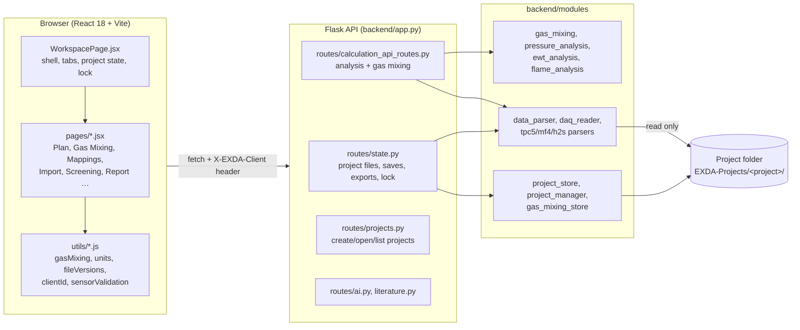
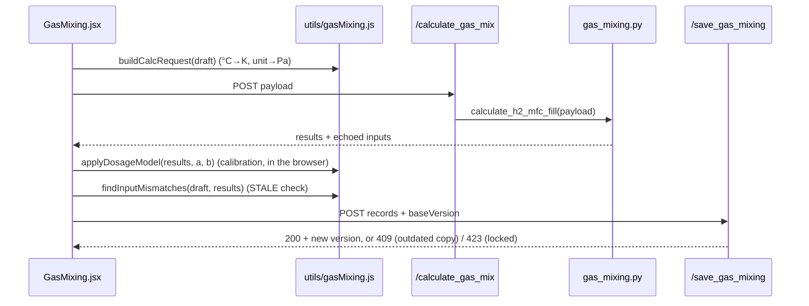

# EXDA developer overview

How the EXDA code is organised, where each calculation lives, how it is
verified today, and what to improve before the calculations are extended.

- **Audience:** developers working on EXDA (not end users; see
  [EXDA-UserGuide.md](../EXDA-User-Guide/EXDA-UserGuide.md) for those).
- **State described:** release 4.0.0 plus the commits after it on
  `CLAUDE-Updates` (November 2026).
- **Evidence:** every finding in section 6 was checked against the code;
  the numbers quoted were reproduced by running the current code.

---

## Contents

1. [Architecture at a glance](#1-architecture-at-a-glance)
2. [Repository map](#2-repository-map)
3. [Request flows](#3-request-flows)
4. [Project data on disk](#4-project-data-on-disk)
5. [Calculation inventory](#5-calculation-inventory)
6. [Findings: calculations](#6-findings-calculations)
7. [Findings: code structure](#7-findings-code-structure)
8. [Verification today](#8-verification-today)
9. [Proposed verification test plan](#9-proposed-verification-test-plan)
10. [Running the tests](#10-running-the-tests)

---

## 1. Architecture at a glance

EXDA is a local web app: a React single-page app in the browser talks to a
Flask API on the same computer. The API reads instrument files and reads and
writes project folders on disk. There is no database; the project folder is
the record.



| Layer | Technology | Entry point |
|---|---|---|
| Frontend | React 18, Vite, Tailwind, Recharts, vitest | [frontend/src/main.jsx](../../frontend/src/main.jsx) → [AppShell.jsx](../../frontend/src/app/AppShell.jsx) → [WorkspacePage.jsx](../../frontend/src/features/workspace/WorkspacePage.jsx) |
| Backend | Python 3, Flask (5 blueprints), NumPy, SciPy, h5py, asammdf, ewtpy, PyWavelets | [backend/app.py](../../backend/app.py) |
| Desktop build | Electron (starts the packaged backend) | [electron/main.cjs](../../electron/main.cjs) |
| Launchers | Shell/batch scripts start backend + Vite and open the browser | `Run-EXDA-*.{sh,command,bat}` |
| Configuration | Host/port defaults | [config/exda-defaults.env](../../config/exda-defaults.env), env vars `EXDA_*` |

Key design rules (from [EXDA-Check.md](EXDA-Check.md), section 0) that every
change must respect:

1. Recorded experimental inputs are never changed by the app.
2. No silent defaults: a missing measured value stays missing.
3. No unit guessing from magnitudes.
4. Inconsistencies in saved records are reported, not repaired.
5. Recalculation is opt-in and never overwrites the original record.

---

## 2. Repository map

Sizes are lines of code (tracked files, November 2026).

### Backend ([backend/](../../backend))

| File | Lines | Role |
|---|---:|---|
| [routes/state.py](../../backend/routes/state.py) | 5 663 | 35 routes: project state, plan/mapping/gas saves, exports (PDF/CSV), raw-file reading, lock, run renames |
| [routes/ai.py](../../backend/routes/ai.py) | 2 038 | AiRA assistant (Ollama), repository context |
| [routes/calculation_api_routes.py](../../backend/routes/calculation_api_routes.py) | 598 | `/analyze`, `/analyze_pressure`, `/analyze_vent`, `/analyze_ewt`, `/preview_multichannel`, `/aggregate_plot`, `/calculate_gas_mix`, `/calculation_verification` |
| [routes/projects.py](../../backend/routes/projects.py) | 254 | Create, open, rename, copy, delete, list projects; default projects folder |
| [modules/pressure_analysis.py](../../backend/modules/pressure_analysis.py) | 580 | Pressure processing chain and metrics (pMax, tMax, impulse), vent time |
| [modules/project_store.py](../../backend/modules/project_store.py) | 579 | Atomic writes, history copies, change log, content versions (409), project lock (423) |
| [modules/project_manager.py](../../backend/modules/project_manager.py) | 517 | Project folder structure, plan save/load, status |
| [modules/data_parser.py](../../backend/modules/data_parser.py) | 493 | Text/CSV parsing (two-column, tables, multichannel waveform), unit conversion for EWT |
| [modules/ewt_analysis.py](../../backend/modules/ewt_analysis.py) | 276 | Empirical wavelet transform, mode energies, filter-cutoff suggestion |
| [modules/gas_mixing.py](../../backend/modules/gas_mixing.py) | 261 | H₂ fill model (ideal gas + MFC timing) |
| [modules/daq_reader.py](../../backend/modules/daq_reader.py) | 231 | Full-resolution channel reads (TPC5, MF4, text) for analysis |
| [modules/gas_mixing_checks.py](../../backend/modules/gas_mixing_checks.py) | 216 | Read-only consistency checks of saved gas/plan records |
| [modules/h2s_parser.py](../../backend/modules/h2s_parser.py) | 196 | H₂ sensor logs: block splitting, duplicates |
| [modules/tpc5_parser.py](../../backend/modules/tpc5_parser.py), [mf4_parser.py](../../backend/modules/mf4_parser.py) | 172, 110 | Preview content (decimated) from TPC5/MF4 |
| [modules/gas_mixing_store.py](../../backend/modules/gas_mixing_store.py) | 163 | Gas record history and audit |
| [modules/plot_interpolation.py](../../backend/modules/plot_interpolation.py) | 152 | Merging series for overlay plots (display only) |
| [modules/flame_analysis.py](../../backend/modules/flame_analysis.py) | 85 | Flame speed from probe crossing times |
| [modules/output_format.py](../../backend/modules/output_format.py) | 56 | Fixed-precision formatting for exports |
| [modules/aira_multi_role.py](../../backend/modules/aira_multi_role.py) | 266 | Not imported anywhere (candidate for removal) |
| [tests/](../../backend/tests) | ~1 700 | unittest suites, reference data, Octave comparison scripts, third-party EWT toolbox |

### Frontend ([frontend/src/](../../frontend/src))

| File | Lines | Role |
|---|---:|---|
| [pages/Plan.jsx](../../frontend/src/pages/Plan.jsx) | 2 115 | Campaign plan, run cards, renames, actual ignition time |
| [features/workspace/WorkspacePage.jsx](../../frontend/src/features/workspace/WorkspacePage.jsx) | 2 081 | App shell: tabs, routing, project open/save, versions, lock, read-only banner |
| [pages/RawDataScreeningCorePage.jsx](../../frontend/src/pages/RawDataScreeningCorePage.jsx) | 1 390 | Pressure and H₂ screening plots; unit and ppm conversions for display |
| [pages/GasMixing.jsx](../../frontend/src/pages/GasMixing.jsx) | 1 369 | Gas mixing form, calculate/save, calibration, record checks |
| [pages/SensorsMapping.jsx](../../frontend/src/pages/SensorsMapping.jsx), [CamerasMapping.jsx](../../frontend/src/pages/CamerasMapping.jsx) | 1 222, 1 049 | Sensor/camera mappings, per-run overrides |
| [features/analysis/PressureAnalysisWorkbench.jsx](../../frontend/src/features/analysis/PressureAnalysisWorkbench.jsx) | 766 | Pressure analysis and CFD-validation UI (advanced mode) |
| [pages/AppCalculationsVerification.jsx](../../frontend/src/pages/AppCalculationsVerification.jsx) | 651 | In-app verification page (Python vs Octave) |
| [pages/EwtAnalysis.jsx](../../frontend/src/pages/EwtAnalysis.jsx) | 475 | EWT UI |
| [features/workspace/hooks/useAnalysisPipeline.js](../../frontend/src/features/workspace/hooks/useAnalysisPipeline.js) | 398 | Calls the analysis endpoints |
| [utils/gasMixing.js](../../frontend/src/utils/gasMixing.js) | 287 | Unit conversion, request building, stale detection, **calibration correction** |
| [utils/units.js](../../frontend/src/utils/units.js) | 75 | Unit tokens and display conversion |

Placeholders: [FlameSpeedAnalysis.jsx](../../frontend/src/pages/FlameSpeedAnalysis.jsx)
(13 lines, no UI). [CFDValidation.jsx](../../frontend/src/pages/CFDValidation.jsx)
reuses the pressure workbench.

### Other

| Path | Role |
|---|---|
| [tests/e2e/](../../tests/e2e) | Playwright end-to-end tests |
| [scripts/](../../scripts) | Packaging/maintenance scripts |
| [docs/](..) | `EXDA-User-Guide/` (guide, Word version, screenshots, videos, build script), `EXDA-Developer-Overview/` (this overview, EXDA-Check.md review brief, downsampling notes), `design/` (architecture animation sources), `assets/` (icons used by the README) |
| [versioning.sh](../../versioning.sh), [VERSIONING.md](../../VERSIONING.md) | Release assistant (allow-listed staging, tag, merge) |

---

## 3. Request flows

### 3.1 Gas mixing: calculate and save



### 3.2 Pressure analysis of a raw file

1. The UI asks `/analyze_pressure_file` (state.py) with project path, file,
   channel and settings.
2. [daq_reader.read_channel](../../backend/modules/daq_reader.py) reads the
   channel at **full resolution** (TPC5 via h5py, MF4 via asammdf, text via
   data_parser) with its unit from the file header.
3. [pressure_analysis.analyze_pressure_signal](../../backend/modules/pressure_analysis.py#L381)
   runs: crop → unit → gauge/absolute (plan P0) → baseline (opt-in) →
   Butterworth (zero-phase) → metrics.
4. The response holds metrics, a full `processing` record (unit origin, filter,
   resampling, reference, baseline, warnings) and a min/max envelope for the plot.

### 3.3 Screening and EWT (preview path)

Screening and EWT use **preview content**: the file is read by
`/read_project_file`, which decimates TPC5/MF4 to at most 200 000 samples by
index picking ([tpc5_parser.py:149](../../backend/modules/tpc5_parser.py#L149)),
and returned as text. Screening converts units **in the browser**
([units.js](../../frontend/src/utils/units.js)); EWT sends the text back to
`/analyze_ewt`. See findings F4 and F5.

### 3.4 Saves, versions and the lock

Every save goes through [project_store](../../backend/modules/project_store.py):
the old file is copied to `History/`, the change is appended to
`History/change_log.jsonl`, and the file is written atomically. Loads return a
content `version`; saves send it back as `baseVersion` and get **409** if the
file changed meanwhile. One window per project holds `.exda.lock`; other
windows get **423** on writes. The window id travels in the `X-EXDA-Client`
header (set by a fetch wrapper in [clientId.js](../../frontend/src/utils/clientId.js)).

---

## 4. Project data on disk

```
EXDA-Projects/<project>/
├── Plan/            <plan>.json (experiments, meta), project_status.json, exported plan CSV/PDF
├── Raw_Data/<run>/<DAQ>/   instrument files (read only for EXDA)
├── Clean_Data/, CFD_Data/, Literature/
├── Procedures/      RAMS/, RAMS-Appendices/, SOPs/ (campaign safety documents)
├── Reports/         daq_systems.json, sensors_mapping.json, cameras_mapping.json,
│                    gas_mixing.json, checklist_state.json, checklist_runs.json,
│                    exported reports <project>_<kind>_<YYYY-MM-DD_HHMMSS>.{pdf,csv}
├── History/         previous versions of every saved file, change_log.jsonl,
│                    gas_mixing_audit.jsonl
└── .exda.lock       present while a window edits the project
```

The default projects folder is `EXDA_PROJECTS_ROOT`, else `EXDA-Projects`
next to the app folder, else `<app>/Projects`
([projects.py](../../backend/routes/projects.py)).

---

## 5. Calculation inventory

Status legend: **V** verified against an independent reference with a
tolerance; **T** unit-tested (behaviour, not independent values);
**–** no tests.

| # | Calculation | Where | Status |
|---|---|---|---|
| C1 | H₂ fill model (mass, volumes, fill time) | [gas_mixing.py:82](../../backend/modules/gas_mixing.py#L82) | T |
| C2 | Calibration (dosage) correction | [gasMixing.js:195](../../frontend/src/utils/gasMixing.js#L195) (browser) | T (vitest) |
| C3 | Gas/plan record consistency checks | [gas_mixing_checks.py:94](../../backend/modules/gas_mixing_checks.py#L94) | T |
| C4 | Pressure units, gauge/absolute, baseline | [pressure_analysis.py:264–362](../../backend/modules/pressure_analysis.py#L298) | T |
| C5 | Butterworth zero-phase filter (+ resampling) | [pressure_analysis.py:119](../../backend/modules/pressure_analysis.py#L119) | T; vs Octave on one fixture (manual) |
| C6 | pMax, tMax, impulse | [pressure_analysis.py:211](../../backend/modules/pressure_analysis.py#L211) | T (analytic triangle); vs Octave (manual) |
| C7 | Vent opening time | [pressure_analysis.py:555](../../backend/modules/pressure_analysis.py#L555) | – |
| C8 | EWT modes, energies, cutoff suggestion | [ewt_analysis.py:119](../../backend/modules/ewt_analysis.py#L119) | shape only; **disagrees** with Octave |
| C9 | Flame speed | [flame_analysis.py:42](../../backend/modules/flame_analysis.py#L42) | – |
| C10 | Preview decimation and display unit conversion | [tpc5_parser.py](../../backend/modules/tpc5_parser.py), [units.js](../../frontend/src/utils/units.js) | T (units) |
| C11 | ppm → vol.% for BGA/H₂ (÷ 10 000) | [RawDataScreeningCorePage.jsx](../../frontend/src/pages/RawDataScreeningCorePage.jsx) | – |
| C12 | Plot merging/interpolation (display only) | [plot_interpolation.py](../../backend/modules/plot_interpolation.py) | T |

### C1 H₂ fill model

Inputs: target H₂ `x` (vol.% / 100), chamber pressure `P` (Pa), temperature
`T` (K), chamber dimensions and volume corrections, MFC setpoint `Q` (SLPM).
Constants: `Ru = 8.314462618 J/(mol·K)`, `M_H2 = 2.01588e-3 kg/mol`,
`T_std = 298.15 K`, `P_std = 101 325 Pa`.

```
V        = L·W·H + V_pipes + V_hotwire − V_welded − V_bolts     (or explicit V_chamber)
n_total  = P·V / (Ru·T)
n_H2     = x · n_total
m_H2     = n_H2 · M_H2                       → grams
V_H2,std = n_H2 · Ru · T_std / P_std         → litres
t_fill   = V_H2,std / (Q · 1e-3 / 60)        → s, min
```

Measured inputs are required (400 if blank); only the four constants above
may default.

### C2 Calibration correction (browser)

`m_corr = a · target + b` (target as fraction or vol.%), and
`t_fill,corr = t_fill · m_corr / m_H2`. Computed in
[applyDosageModel](../../frontend/src/utils/gasMixing.js#L195) and **saved as
part of the record** (`mH2CorrectedG`, `fillTimeCorrected_s`).

### C4–C6 Pressure chain

Order (fixed): crop → unit conversion → gauge/absolute → baseline → filter
→ metrics.

- **Units:** from the file header (`[bar]`, `[Pa]` …) or chosen explicitly;
  unknown units stay raw, volts are never converted.
- **Absolute:** `p_abs = p_gauge + P0`, P0 from the plan (never 101 325).
- **Baseline (opt-in):** subtract mean/median of a window.
- **Filter:** `scipy.signal.butter(order, fc, output='sos')` +
  `sosfiltfilt`. Non-uniform time axes are linearly resampled first, and
  this is recorded. Because the filter runs forward and backward, the
  magnitude response is squared: **−6 dB at the cutoff and an effective
  order of 2 × order**.
- **Metrics:** `pMax = max(p)`, `tMax` at the peak (DAQ time axis),
  `impulse = ∫ p dt` by trapezoid **from the first sample of the window**
  to the first sample after the peak where `p ≤ f·pMax` (default f = 5%).

### C8 EWT

Signal → `normalize_pressure_to_kpa` → uniform resampling → `ewtpy.EWT1D(N)`
→ energy per mode `Σ m²` (in %) and the periodogram peak frequency per mode.
It is run twice: N modes for display and ≥ 8 modes for the cutoff suggestion.
The suggested cutoff is the lowest mode-peak frequency where the cumulative
energy reaches 95%. The physical labels per mode use fixed thresholds
(< 30 Hz flame, < 100 Hz Helmholtz/external, > 350 Hz high frequency).

### C9 Flame speed

Crossing time of 0.5 per probe → `v = |Δx/Δt|` between neighbouring probes,
with `x` measured from a fixed ignition position of 2.4 m.

---

## 6. Findings: calculations

Ordered by impact on results. "Verified" means the effect was reproduced by
running the current code.

### High

**F1 — EWT crashes when the second decomposition fails** (verified).
[ewt_analysis.py:193–194](../../backend/modules/ewt_analysis.py#L193):
`perform_ewt_analysis` returns `None` on failure, and
`calculate_energy(None)` raises `TypeError`. The first call is guarded and
this one is not. The user gets a 500 error instead of the warning.
*Fix:* return the first-pass result with a warning when the knee pass fails;
add a test with a mocked failure.

**F2 — EWT energy includes the DC offset, so the suggested cutoff depends on
gauge vs absolute pressure** (verified). The same 5 + 50 Hz test signal gives a
suggested cutoff of **50 Hz** as gauge and **4 Hz** with a 101.3 kPa offset,
because mode 0 then holds 99.99% of the energy.
*Fix:* subtract the mean (or the baseline window) before computing
energies, and record that in the summary.

**F3 — The impulse depends on where the window starts** (verified). The
integral starts at the first sample of the window, not at ignition or at the
start of the positive phase. On the reference fixture, 1 s of pre-trigger
data at 0.05 kPa (a small drift) raises the impulse from 0.4109 to
0.4609 kPa·s (**+12%**).
*Fix:* define the integration start explicitly (ignition time, or the last
upward crossing of `f·pMax` / 0 before the peak), report it in `processing`,
and test it with a shifted window.

**F4 — EWT runs on decimated preview data without an anti-aliasing filter.**
Preview content keeps every k-th sample
([tpc5_parser.py:149](../../backend/modules/tpc5_parser.py#L149)), and EWT then
analyses that signal. Content above the new Nyquist frequency folds into the
analysed band, and the EWT `fs` differs from the analysis `fs`. The suggested
cutoff can therefore point at an aliased peak.
*Fix:* give EWT the full-resolution channel via `daq_reader` (as the pressure
analysis does), or decimate with `scipy.signal.decimate` (filtered), and
record `fs` and the decimation factor.

**F5 — The EWT unit falls back to `bar`.**
[useAnalysisPipeline.js:97](../../frontend/src/features/workspace/hooks/useAnalysisPipeline.js#L97)
sends `DEFAULT_INPUT_UNIT = 'bar'` when the EWT unit is "from file" or unset,
so a Pa file is scaled ×100 000 as if it were bar. Frequencies and energy
percentages are scale-invariant, so the suggested cutoff is not affected;
plotted amplitudes and units are. This breaks the "no unit guessing" rule.
*Fix:* pass `auto` through (the backend reads the header unit), as the
pressure analysis does.

### Medium

**F6 — Python EWT and Octave EWT disagree.** Stored results on the same
fixture ([backend/tests/results/](../../backend/tests/results)):

| Mode | Octave peak (Hz) | Octave energy % | Python peak (Hz) | Python energy % |
|---:|---:|---:|---:|---:|
| 0 | 1.33 | 99.19 | 4.02 | 82.99 |
| 1 | 70.47 | 0.58 | 10.04 | 16.19 |
| 2 | 119.66 | 0.21 | 70.28 | 0.47 |
| 3 | 178.16 | 0.01 | 70.28 | 0.15 |
| 4 | 212.73 | 0.004 | 120.48 | 0.19 |

The two implementations (ewtpy vs the Empirical-Wavelets toolbox) detect
different boundaries; Python also gives two modes the same peak (70.28 Hz).
EWT output is therefore **not verified**, and the "guess" labels and the cutoff
suggestion inherit that.
*Fix:* fix the boundary-detection settings so both use the same method
(e.g. local maxima, same N, same regularisation), compare on synthetic
signals with known frequencies first, then on the fixture; until then,
label EWT results as indicative in the UI.

**F7 — The filter strongly reduces peaks, and that is not reported.** On the
reference fixture a 20 Hz, order-4 zero-phase filter lowers pMax from 7.10 to
5.54 kPa (−22%). The default cutoff is 100 Hz; the right value depends on the
signal.
*Fix:* always return the unfiltered pMax next to the filtered one, and offer
a cutoff sensitivity table (pMax/impulse at 2–3 cutoffs) in the processing
record.

**F8 — The calibration correction is computed in the browser.** The base
model (C1) runs in Python, but the corrected mass and fill time that are
**saved in the record** come from JavaScript (C2). Two languages share one
result, and the backend cannot recompute or check it independently (the record
checks re-derive it, but only for consistency).
*Fix:* move `applyDosageModel` to `gas_mixing.py`, return the corrected values
from `/calculate_gas_mix`, and keep the frontend for display only.

**F9 — Gas-model assumptions are implicit.** These should be written down
and checked, not changed silently:
- `P` is treated as the final total pressure of the mixture (constant-pressure
  fill with venting). For a closed-vessel fill from `P0`, the H₂ amount is
  `x/(1−x) · n_air`, which is larger (+19% at 16 vol.%).
- **Standard conditions must match the MFC calibration.** 25 °C (current
  constant) vs 0 °C ("normal" litres) changes the fill time by 9.2%
  (298.15/273.15).
- Relative humidity is recorded but not used. That is correct for the H₂
  amount, but it should be stated.
- No uncertainty is propagated (P, T, V, MFC accuracy).

*Fix:* document the fill procedure in the module docstring, make the MFC
standard temperature a recorded per-DAQ/MFC property, and add an
uncertainty estimate (linear propagation is enough here).

**F10 — Name-based unit guessing can mislabel channels.**
[calculation_api_routes.py:368](../../backend/routes/calculation_api_routes.py#L368)
marks a channel without a header unit as a trigger (V) when its name contains
`ign` (which also matches "s**ign**al") or `volt`, and as ppm when it
contains `conc`/`hydrogen`. It only applies when the header has no unit, but
it is magnitude-free guessing by name.
*Fix:* match whole words/tokens and show "unit from channel name" as the
origin in the UI.

### Low

- **F11 — Metrics are returned as strings with 4 decimals** (`f"{p_max:.4f}"`,
  [pressure_analysis.py:475](../../backend/modules/pressure_analysis.py#L475)).
  This loses precision for small values (e.g. bar or MPa output) and forces
  re-parsing. Return floats and format in the UI. `calculate_metrics` also
  returns `0.0` for "no data", which looks like a measurement; return `None`.
- **F12 — Vent time** uses a fixed 0.5 threshold on an unscaled trace
  ([pressure_analysis.py:555](../../backend/modules/pressure_analysis.py#L555)),
  has no tests, and its plot uses stride decimation.
- **F13 — Flame speed** has a hard-coded ignition position (2.4 m), a fixed
  0.5 crossing threshold, `abs()` that hides ordering errors, no tests and no UI.
  Treat it as unfinished: parameterise it, take probe positions from the
  sensor mapping, and test with synthetic probe traces.
- **F14 — Impulse end threshold:** values > 1 are read as percent
  (`5` → 5%), so `1` means 100% and `1.5` means 1.5%. Accept one unit only.
- **F15 — Baseline after crop:** a baseline window outside the analysis
  window fails ("contains no samples"). Compute the baseline on the uncropped
  signal or say so in the error.
- **F16 — EWT labels** ("Flame Propagation …", "Helmholtz …") come from fixed
  frequency thresholds that are vessel-specific. Make them configurable or
  show them as hints.

---

## 7. Findings: code structure

| # | Finding | Suggestion |
|---|---|---|
| S1 | `routes/state.py` has 5 663 lines and 35 routes (file I/O, exports, lock, renames, analysis). | Split into blueprints: `files`, `records` (plan/mappings/gas), `exports`, `lock`, `runs`. Move PDF/CSV export code to a module. |
| S2 | `WorkspacePage.jsx` (2 081) and `Plan.jsx` (2 115) hold most frontend state and logic. | Extract hooks (`useProjectLock`, `useProjectSave`, `usePlanEditor`) and keep pages presentational. |
| S3 | Four pressure-unit tables: [pressure_analysis.py:36](../../backend/modules/pressure_analysis.py#L36) (has psi), [data_parser.py:481](../../backend/modules/data_parser.py#L481) (no psi), [units.js:38](../../frontend/src/utils/units.js#L38) (no psi), [gasMixing.js:38](../../frontend/src/utils/gasMixing.js#L38) (Pa-based). | One backend table (`units.py`) exported as JSON to the frontend; test both sides against the same cases. |
| S4 | Duplicate helpers: `resample_uniform` in pressure_analysis and ewt_analysis; three `parse_data_content` wrappers; `flame_analysis` has its own parser. | One `signal_utils.py` (resample, decimate, uniformity check) and one parser entry point. |
| S5 | Two read paths: full-resolution `daq_reader` (analysis) and decimated preview text (screening, EWT, vent, flame). | Make analysis always use `daq_reader`; keep preview text for display only. |
| S6 | `aira_multi_role.py` and `ArchitectureFlowMap.jsx` are not used. | Remove (see the earlier file audit). |
| S7 | No continuous integration: tests run only when someone runs them. | GitHub Actions: backend unittest + vitest + eslint on every push (free for public repos). |
| S8 | Analysis endpoints catch `Exception` and return `{"error": str(e)}` with 500. | Map known errors (PressureAnalysisError, ValueError) to 400 and log the rest with a traceback. |

---

## 8. Verification today

### Test suites

| Suite | Files | Tests | Notes |
|---|---|---:|---|
| Backend unittest | 11 in [backend/tests/](../../backend/tests) | 85 | 5 skipped: need week-27 data or the removed `Projects/VH2D-Project` file |
| Frontend vitest | 7 in [frontend/tests/](../../frontend/tests) | 41 | Gas-mixing logic, units, mappings, versions, formatting |
| End-to-end | 2 in [tests/e2e/](../../tests/e2e) | – | Playwright; need a running app |
| Octave comparison | [backend/tests/scripts/comparison/](../../backend/tests/scripts/comparison) | – | Manual scripts writing CSVs to `backend/tests/results/` |

### What is independently verified

| Quantity | Reference | Agreement | Automated? |
|---|---|---|---|
| pMax, tMax (raw) | Octave, 1 fixture | identical to 5 decimals | No (static CSV) |
| impulse (raw) | Octave | 1e-4 relative (0.41089 vs 0.41093) | No |
| pMax (filtered 20 Hz) | Octave `filtfilt` | 0.05% (5.53381 vs 5.53673): different edge padding | No |
| EWT peaks/energies | Octave toolbox | **disagree** (F6) | No |
| Gas mixing | – | hand values only in tests | – |
| Analytic pMax/impulse | triangle pulse (6.5, 17.0) | exact | Yes |

### Gaps

- **The comparison scripts still use the removed unit guess.** Both the
  Python script
  ([verify_pressure_metrics_python.py:45](../../backend/tests/scripts/comparison/python/verify_pressure_metrics_python.py#L45))
  and the Octave core (`verify_pressure_metrics_core.m`) convert by magnitude
  (`|y| > 1000 → (y − 101325)/1000`), which the app no longer does. They
  verify a different chain than the app. The fixture is in kPa, so today's
  numbers are unaffected.
- **The in-app verification page compares live Python results with Octave
  results stored once** at fixed settings (20 Hz, order 4, 5%). Changing the
  settings on the page compares different things, and there is no pass/fail
  tolerance.
- **The Butterworth reference test is skipped**, because it reads
  `Projects/VH2D-Project/...`, which no longer exists
  ([test_calculations_reference.py:48](../../backend/tests/test_calculations_reference.py#L48)).
  The same signal is already a fixture (`reference_data/experimental_data_001_clean.csv`).
- **The fixture is coarse** (348 samples, about 794 Hz): too few to test
  filters near real DAQ rates (tens of kHz) or decimation effects.
- **Untested:** vent time (C7), flame speed (C9), the ppm conversion (C11),
  the absolute-pressure path against a reference, and the frontend–backend
  agreement for the calibration correction.

---

## 9. Proposed verification test plan

Goal: each calculation has (a) analytic tests with exact answers, (b) an
independent reference with an agreed tolerance, run automatically, and
(c) property tests that catch whole classes of errors.

### 9.1 Layers

| Layer | What | Examples |
|---|---|---|
| L1 Analytic | Inputs with closed-form answers | Triangle/rectangle pulse → exact impulse; Friedlander waveform `p(t)=Ps(1−t/td)e^(−bt/td)` → analytic impulse `Ps·td·(1/b − (1−e^(−b))/b²)`; sine at fc through filtfilt → gain 0.5 (−6 dB); gas mixing at hand-checked values (e.g. 16 vol.%, 101 325 Pa, 293.15 K, 1 m³ → m_H2 = 13.408 g; at 10 SLPM → 976.4 s) |
| L2 Reference | Same inputs through an independent implementation (Octave/MATLAB, or a second Python implementation written from the equations) | pMax/tMax/impulse/filter on 3–5 fixtures at several settings; gas mixing vs the MATLAB `AuxFcn_H2_MFC_FillCalculator_000` |
| L3 Properties | Relations that must hold for any input | Unit scaling: bar vs Pa input give identical kPa metrics; time shift: tMax shifts, pMax/impulse unchanged; offset: pMax shifts by the offset; linearity of the filter; EWT energies sum to 100%; gas mass ∝ P·V/T and ∝ x |
| L4 Regression | Real (anonymised) runs with stored expected results | Week-27 DAQ1 channel subset at full rate; fails if a refactor changes a result beyond tolerance |
| L5 Cross-language | One set of JSON test vectors used by pytest **and** vitest | Unit conversions, calibration correction, stale-input detection |

### 9.2 Tolerances

| Quantity | Tolerance | Why |
|---|---|---|
| Gas mixing outputs | 1e-9 relative | Closed-form; only floating point |
| pMax, tMax raw | exact sample / 1e-12 | No arithmetic beyond max |
| Impulse | 1e-6 relative vs analytic (fine grid); 1e-4 vs Octave | Trapezoid differences at the end index |
| Filtered pMax | 1e-3 relative vs Octave | Edge padding differs (scipy `padlen` vs Octave) — or align padding and tighten |
| EWT peak frequencies | ± one frequency bin (fs/N) on synthetic tones | After F6 is fixed |

### 9.3 Suggested layout

```
backend/tests/verification/
├── vectors/                 JSON test vectors (inputs + expected + tolerance)
│   ├── gas_mixing.json      shared with frontend/tests (L5)
│   ├── units.json
│   └── pressure_analytic.json
├── fixtures/                small signals (kPa, s) incl. one at a real DAQ rate
├── reference/               Octave/MATLAB outputs, regenerated by one script,
│                            each file stating the settings used
├── test_gas_mixing_reference.py
├── test_pressure_reference.py    parameterised over fixtures × settings
├── test_properties.py
└── regenerate_reference.sh       runs Octave and rewrites reference/
```

Rules for the reference files: each one records its inputs, settings,
tool and version; the comparison test reads the settings from the file
(so the in-app page and the tests compare like with like); and the Octave
scripts take units explicitly instead of guessing.

### 9.4 Order of work

1. Fix F1 (crash) and F5 (EWT unit) — small, independent.
2. Point the skipped Butterworth test at the existing fixture; remove the
   magnitude guess from both comparison scripts; turn the stored Octave CSVs
   into automated tolerance tests (§9.2).
3. Add L1 analytic tests for impulse (incl. window-start sensitivity, F3) and
   the filter gain at the cutoff.
4. Decide the impulse start definition (F3) and the EWT input path (F2, F4);
   implement them with tests.
5. Move the calibration correction to the backend (F8) with shared vectors (L5).
6. Add CI (S7) so all of the above runs on every push.
7. Then extend the calculations (uncertainty for gas mixing, flame speed).

---

## 10. Running the tests

```bash
# backend (from the repository root)
python3 -m unittest discover -s backend/tests -v

# frontend
npx vitest run --config frontend/vitest.config.js

# lint
npx eslint --config frontend/eslint.config.js frontend

# Octave comparison (writes backend/tests/results/*.csv)
bash backend/tests/run_octave_verification.sh
bash backend/tests/run_octave_ewt_verification.sh
```

Tests never write to project folders; they use temporary folders. Tests that
need real campaign data skip when it is not present.
