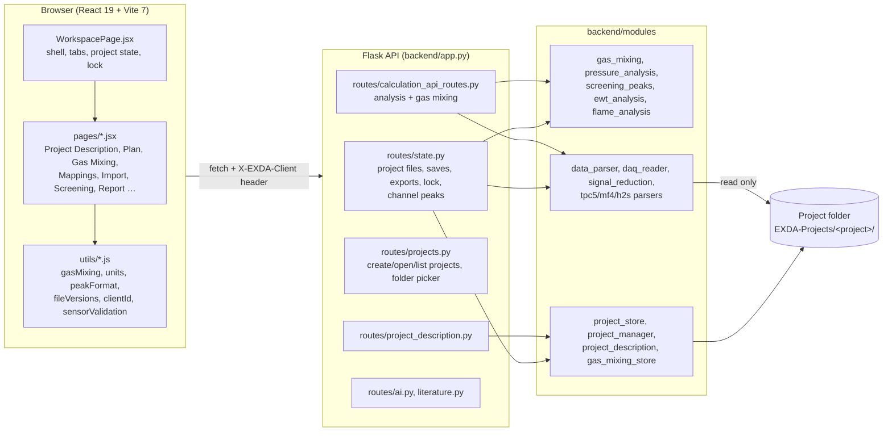
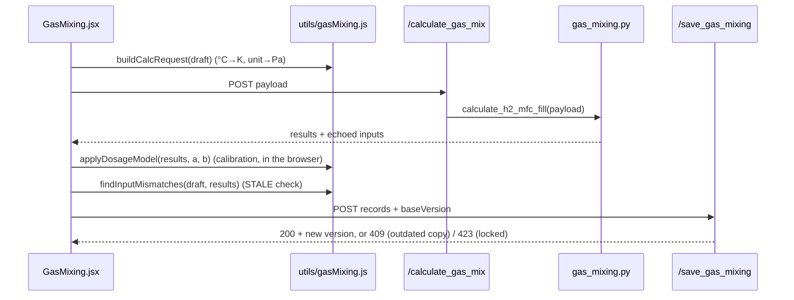
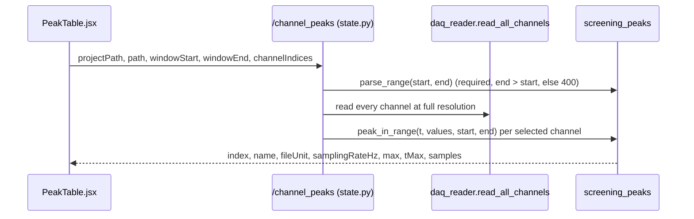

# EXDA developer overview

How the EXDA code is organised, where each calculation lives, how it is
verified today, and what to improve before the calculations are extended.

- **Audience:** developers working on EXDA (not end users; see
  [EXDA-UserGuide.md](../EXDA-User-Guide/EXDA-UserGuide.md) for those).
- **State described:** release 5.0.5 on `CLAUDE-Updates`
  (26 November 2026). Releases 4.0.13–5.0.5 changed the install layout,
  the shortcuts, the projects folder, the capabilities cloud, the picker
  start folder, Windows path handling and added the technical skills field
  (all in the table below). Sections 1–4, 7, 8 and 10 are
  updated for this state. The findings in section 6 were first written for
  4.0.0. The calculation modules they refer to (`pressure_analysis`,
  `ewt_analysis`, `gas_mixing`, `flame_analysis`, `useAnalysisPipeline`)
  have not changed since, so F1–F16 still apply. F17–F19 come from the
  "no default values" audit of November 2026.
- **Evidence:** every finding in section 6 was checked against the code;
  the numbers quoted were reproduced by running the current code.
- **Development and AI assistance:** EXDA was designed and developed by
  Javier I. Camacho, with the assistance of AI coding tools (OpenAI Codex and
  Anthropic Claude, including Claude Opus 5.5) for code, tests and
  documentation, including this overview. The tools worked within the
  repository's own checks (unit tests, lint, the allow-listed release script);
  every change was reviewed, and every release was run, by the author.

## Changes since 4.0.0 that matter for developers

| Area | Change | Where |
| --- | --- | --- |
| Preview reduction | Min/max envelope instead of keeping every k-th sample; readers report the true sample count and rate (`sampleInfo`) | [signal_reduction.py](../../backend/modules/signal_reduction.py), [DOWNSAMPLING_FLOW.md](DOWNSAMPLING_FLOW.md) |
| Screening peak table | Max and time of max per selected channel in a required time range, read at full resolution, not saved | [screening_peaks.py](../../backend/modules/screening_peaks.py), `/channel_peaks` in [state.py](../../backend/routes/state.py#L3220), [PeakTable.jsx](../../frontend/src/components/PeakTable.jsx) |
| Project marker | New projects get `exda-project.json`; older projects are still recognised by their `Plan/` content | [project_manager.py:71](../../backend/modules/project_manager.py#L71) |
| Project Description | New first tab, stored in `Plan/project_description.json` (own blueprint) | [project_description.py](../../backend/modules/project_description.py), [routes/project_description.py](../../backend/routes/project_description.py) |
| Plan file selection | `project_description.json` and the status file are never picked as the plan | `NON_PLAN_FILENAMES` in [project_manager.py:203](../../backend/modules/project_manager.py#L203) |
| Capabilities cloud | Projects page card with the capability terms (methods, measured quantities, facility, fuels, keywords) of the listed projects, sized by the number of projects and packed on a spiral (some smaller words vertical); colours are the theme tokens `--cloud-*` (index.css), a categorical palette checked with a colour-vision validator in both themes; follows the folder and status filters; click a word to search, with a visible filter bar and Show all. Computed in the browser from `capabilities` in `/list_projects`; read-only | [CapabilityCloud.jsx](../../frontend/src/components/CapabilityCloud.jsx), [capabilityCloud.js](../../frontend/src/utils/capabilityCloud.js), `CAPABILITY_FIELD_IDS` in [project_description.py](../../backend/modules/project_description.py) |
| Design guide and readability | [EXDA-Design-Guide.md](../EXDA-Design-Guide.md) replaces `design_guidelines.json`: tokens, type (minimum 11 px), components, light/dark and chart-colour rules. Warning and error tokens raised to ≥ 4.5:1 text contrast; checkboxes use `primary`; status badges and the read-only banner use tokens instead of fixed colours; top-bar buttons never break inside a word; 8–10 px text raised to 11 px on MVP screens | `index.css`, `WorkspacePage.jsx`, `Projects.jsx`, MVP pages |
| Fewer duplicate requests | Pages fetched the same lists several times per visit (StrictMode runs effects twice; Projects counted then loaded each folder; plan summaries were re-requested). Read requests now go through [sharedFetch.js](../../frontend/src/utils/sharedFetch.js): identical requests in flight share one answer, answers are reused for 2 s, any POST/PUT/DELETE clears them (`clientId.js` fetch wrapper), and Refresh/reloads after changes force fresh data. Measured: Projects page 6× → 1× per folder. Windows launcher now shows backend messages in its window (no hidden temp log); launchers hide the harmless Browserslist notice and the browser data was updated | `sharedFetch.js`, `Projects.jsx`, `Home.jsx`, `Run-EXDA-*` |
| Backend port and start check | Default backend port 5000 → 5077 (macOS AirPlay Receiver also listens on 5000 and answered the browser instead of EXDA, so the page showed "Backend not running?" although the backend had started). `/exda_health` identifies EXDA; all three launchers run [check_exda_backend.py](../../scripts/check_exda_backend.py) after starting the backend and stop with a clear message if nothing or another program answers. The launchers no longer start the backend in debug mode (no Werkzeug debugger, no double start); `EXDA_BACKEND_DEBUG=1` switches it on for development | `config/exda-defaults.env`, `backend/app.py`, `Run-EXDA-*` |
| Theme tokens everywhere | All ~500 fixed palette classes moved to theme tokens and the legacy `zinc` compatibility layer in `index.css` removed (only modal backdrops keep `bg-black/60–80`); plot channels use validated `--series-1..8` (canvas via `utils/themeColors.js`, redrawn on theme switch); Plan timeline status/group colours on tokens; markdown styles fixed for light theme; 11 px minimum also on advanced screens and in charts; paths wrap only at separators (`PathText`) | `index.css`, `themeColors.js`, `PathText.jsx`, `HighResMultiChannelPlot.jsx`, `Plan.jsx` |
| Technical skills | New standard Project Description field, picked from the team's skills list (categories → skills) so the same skill has one name; missing skills are added on purpose (category required, `addedBy`/`addedAt` recorded); feeds the capabilities cloud (violet). Projects store the names as text; names outside the list are kept and marked | [skills_catalog.py](../../backend/modules/skills_catalog.py) (`/skills_catalog`, `/add_skill_to_catalog`), [SkillPicker.jsx](../../frontend/src/components/SkillPicker.jsx), [skillsCatalog.js](../../frontend/src/utils/skillsCatalog.js) |
| Windows folder names | Projects page folder chips show only the folder name (`folderName` in pathCrumbs.js), as on macOS/Linux; CFD import helpers accept `\\` | [Projects.jsx](../../frontend/src/pages/Projects.jsx), [dataImportRules.js](../../frontend/src/features/workspace/dataImportRules.js) |
| Run data files on Windows | Relative paths sent to the browser (`/list_raw_data`, project-state data files, Literature) always use "/", as stored in the plan; before, Windows sent "\\", so the run card found no files. The run card never drops linked files on save; links to files not found on this computer are listed and only removed with "Unlink these files" | [runFiles.js](../../frontend/src/utils/runFiles.js), `Plan.jsx`, [test_raw_data_listing.py](../../backend/tests/test_raw_data_listing.py) |
| Picker start folder | Open/Create Project start in a projects folder (the one holding the last project, else the default `EXDA-Projects`), never at an old project path that may no longer exist | [pickerStart.js](../../frontend/src/utils/pickerStart.js), used by `WorkspacePage.jsx` and `ProjectPickerModal.jsx` |
| Projects page | Folder picker styled like the app, project groups, collapsible | [ProjectPickerModal.jsx](../../frontend/src/components/ProjectPickerModal.jsx), [Projects.jsx](../../frontend/src/pages/Projects.jsx) |
| Page headers | One `PageHeader` component for every tab | [PageHeader.jsx](../../frontend/src/components/PageHeader.jsx) |
| Launchers | `Setup-EXDA-*` installs requirements on first start; `Run-EXDA-*` only checks and starts; recommended layout `EXDA/` with the app, `EXDA-Projects/` and the EXDA shortcut | repository root, [make_shortcuts.ps1](../../scripts/make_shortcuts.ps1) |
| User guide | Media regenerated from synthetic demo projects by two scripts | [docs/EXDA-User-Guide/tools/](../EXDA-User-Guide/tools) |

---

## Contents

1. [Architecture at a glance](#1-architecture-at-a-glance)
2. [Repository map](#2-repository-map)
3. [Request flows](#3-request-flows)
4. [Project data on disk](#4-project-data-on-disk)
5. [Calculation inventory](#5-calculation-inventory)
6. [Findings: calculations](#6-findings-calculations)
7. [Findings: code structure](#7-findings-code-structure)
8. [Verification today](#8-verification-today)
9. [Proposed verification test plan](#9-proposed-verification-test-plan)
10. [Running the tests](#10-running-the-tests)

---

## 1. Architecture at a glance

EXDA is a local web app: a React single-page app in the browser talks to a
Flask API on the same computer. The API reads instrument files and reads and
writes project folders on disk. There is no database; the project folder is
the record.



| Layer | Technology | Entry point |
| --- | --- | --- |
| Frontend | React 19, Vite 7 (Node ^20.19 or ≥ 22.12), Tailwind, uPlot (screening plots), Recharts, vitest | [frontend/src/main.jsx](../../frontend/src/main.jsx) → [AppShell.jsx](../../frontend/src/app/AppShell.jsx) → [WorkspacePage.jsx](../../frontend/src/features/workspace/WorkspacePage.jsx) |
| Backend | Python 3, Flask (6 blueprints), NumPy, SciPy, h5py, asammdf, ewtpy, PyWavelets | [backend/app.py](../../backend/app.py) |
| Desktop build | Electron (starts the packaged backend) | [electron/main.cjs](../../electron/main.cjs) |
| Launchers | First start: `Setup-EXDA-*` creates the Python environment (`.venv`, `.venv-mac`, `.venv-win`; never committed) and installs npm packages. Later starts: `Run-EXDA-*` checks the requirements, starts backend + Vite and opens the browser | `Setup-EXDA-*.{sh,command,bat}`, `Run-EXDA-*.{sh,command,bat}` |
| Configuration | Host/port defaults | [config/exda-defaults.env](../../config/exda-defaults.env), env vars `EXDA_*` |

### What the setup installs, and where

EXDA runs on colleagues' computers, so the setup is deliberately contained.
Users can see the same information in [RUN_EXDA.md](../../RUN_EXDA.md)
("Get EXDA", "The EXDA shortcut", "Where EXDA installs things") and in the
user guide. The setup scripts print the paths at the start and at the end.

Recommended layout (the user creates `EXDA/`, EXDA creates the rest):

```text
EXDA/
├── EXDA                shortcut (EXDA.lnk on Windows, relative symlink to EXDA.app on macOS)
├── EXDA-dashboard/     the app (repository); every package is installed in here
└── EXDA-Projects/      project data, created by the backend on first use
```

| What | Where | Done by | Admin rights |
| --- | --- | --- | --- |
| Python packages | `.venv-win` / `.venv-mac` / `.venv` inside the app folder | `python -m venv` + `pip install -r backend/requirements*.txt` | No |
| Frontend packages | `node_modules` inside the app folder | `npm install` (never `-g`) | No |
| EXDA shortcut (Windows) | User's Start menu (`Programs`) always; the parent `EXDA` folder when the app is in its own folder, otherwise the app folder (`EXDA.lnk`, git-ignored); the Desktop only after a yes (an existing Desktop shortcut is just updated) | [scripts/make_shortcuts.ps1](../../scripts/make_shortcuts.ps1), called by `:make_shortcuts` | No |
| EXDA shortcut (macOS) | Relative symlink `EXDA` → `<app>/EXDA.app` in the parent folder, when the app is in its own folder; never the Dock or Desktop | `Setup-EXDA-MAC.command` (`in_own_folder`, `ln -sfn`) | No |
| Projects folder | `EXDA-Projects` next to the app folder, created when missing (unless an older `<app>/Projects` already holds projects) | `_projects_root_default()` in [projects.py](../../backend/routes/projects.py) | No |
| Python, only if missing and only after the user accepts | Windows: `winget … Python.Python.3.12 --scope user`; macOS: `brew install python@3.12` | `offer_install` | No |
| Node.js, only if missing and only after the user accepts | Windows: `winget … OpenJS.NodeJS.LTS` (the Node installer asks Windows for permission); macOS: `brew install node` | `offer_install` | Windows: yes (UAC prompt) |
| Download caches | npm and pip caches in the user folder (their normal behaviour) | npm, pip | No |

What the scripts never do (checked 25 November 2026):

- They never use `sudo`.
- They never edit the registry or shell profiles (`.bashrc`, `.zshrc`).
- They never change PATH permanently. `seed_path` / `seed_gui_path` add the
  usual Node.js and Python folders only for the running window.
- They never install npm or pip packages globally, and never start services
  or scheduled tasks.
- On Linux they install nothing system-wide. Node.js and Python must already
  be there.
- `-ExecutionPolicy Bypass` applies only to the PowerShell process that runs
  `make_shortcuts.ps1`. It does not change the computer's policy.

"In its own folder" (both systems): the parent is not a general place (drive
root, user folder, Desktop, Documents, Downloads; on macOS also a volume root)
and is either named `EXDA…` or holds nothing but `EXDA…` items and hidden
files. Otherwise setup prints a tip to use an `EXDA` folder. The macOS link is
relative, so it survives moving the whole `EXDA` folder. `EXDA.app` resolves
its real folder with `pwd -P`, so it also works when started through the link.

When the app folder is inside OneDrive, iCloud Drive, Dropbox or Google
Drive, the Windows and macOS setups warn and ask before continuing, because
syncing about 1–2 GB of package files is slow and can break the environment.

**Removing or replacing EXDA** therefore means replacing or deleting the app
folder only (plus the shortcuts, to remove it completely). Projects are safe
because the default projects folder is never inside the app folder for new
installs: `_projects_root_default()` creates `EXDA-Projects` next to the app
when it is missing (fixed S9). An older install whose `<app>/Projects` already
holds something keeps using it, so no project disappears from view. For that
case `/list_directories` returns `insideAppFolder: true` and
`recommendedProjectsRoot`, and the Projects page shows a warning with both
paths. EXDA never moves project data itself.

**Rule for changes to the launchers:**

- Anything installed goes inside the app folder.
- Anything outside it (a program, a shortcut) needs an explicit yes from the
  user and must be listed in this table, in RUN_EXDA.md and in the user
  guide.
- Batch files must keep CRLF line endings (see `.gitattributes`). Inside
  `( … )` blocks, use `!VAR!` for paths and keep parentheses out of `echo`
  text.

Key design rules (from [EXDA-Check.md](EXDA-Check.md), section 0) that every
change must respect:

1. Recorded experimental inputs are never changed by the app.
2. No silent defaults: a missing measured value stays missing.
3. No unit guessing from magnitudes.
4. Inconsistencies in saved records are reported, not repaired.
5. Recalculation is opt-in and never overwrites the original record.

---

## 2. Repository map

Sizes are lines of code (tracked files, November 2026).

### Backend ([backend/](../../backend))

| File | Lines | Role |
| --- | ---: | --- |
| [routes/state.py](../../backend/routes/state.py) | 5 813 | 40 routes: project state, plan/mapping/gas/checklist saves, exports (PDF/CSV), raw-file reading, channel peaks, procedures, lock, run renames |
| [routes/ai.py](../../backend/routes/ai.py) | 2 040 | AiRA assistant (Ollama), repository context |
| [routes/calculation_api_routes.py](../../backend/routes/calculation_api_routes.py) | 607 | `/analyze`, `/analyze_pressure`, `/analyze_vent`, `/analyze_ewt`, `/preview_multichannel`, `/aggregate_plot`, `/calculate_gas_mix`, `/calculation_verification` |
| [routes/projects.py](../../backend/routes/projects.py) | 453 | Create, open, rename, copy, delete, list projects (with capability terms); default projects folder created next to the app; projects overview and plan summary; folder listing for the picker; default projects folder |
| [routes/project_description.py](../../backend/routes/project_description.py) | 108 | `/get_project_description`, `/save_project_description`, `/project_description_suggestions` |
| [modules/project_manager.py](../../backend/modules/project_manager.py) | 594 | Project folder structure, project marker, plan save/load, status |
| [modules/pressure_analysis.py](../../backend/modules/pressure_analysis.py) | 580 | Pressure processing chain and metrics (pMax, tMax, impulse), vent time |
| [modules/project_store.py](../../backend/modules/project_store.py) | 579 | Atomic writes, history copies, change log, content versions (409), project lock (423) |
| [modules/data_parser.py](../../backend/modules/data_parser.py) | 493 | Text/CSV parsing (two-column, tables, multichannel waveform), unit conversion for EWT |
| [modules/daq_reader.py](../../backend/modules/daq_reader.py) | 317 | Full-resolution channel reads (TPC5, MF4, text): one channel (`read_channel`) or all (`read_all_channels`) |
| [modules/ewt_analysis.py](../../backend/modules/ewt_analysis.py) | 276 | Empirical wavelet transform, mode energies, filter-cutoff suggestion |
| [modules/gas_mixing.py](../../backend/modules/gas_mixing.py) | 261 | H₂ fill model (ideal gas + MFC timing) |
| [modules/gas_mixing_checks.py](../../backend/modules/gas_mixing_checks.py) | 216 | Read-only consistency checks of saved gas/plan records |
| [modules/h2s_parser.py](../../backend/modules/h2s_parser.py) | 196 | H₂ sensor logs: block splitting, duplicates |
| [modules/folder_dialog.py](../../backend/modules/folder_dialog.py) | 196 | Native folder dialog fallback (per OS) |
| [modules/tpc5_parser.py](../../backend/modules/tpc5_parser.py), [mf4_parser.py](../../backend/modules/mf4_parser.py) | 186, 123 | Preview content from TPC5/MF4, reduced with the min/max envelope |
| [modules/project_description.py](../../backend/modules/project_description.py) | 196 | Project Description schema (`exda-project-description/1`), validation, suggestions from other projects |
| [modules/checklist_definition.py](../../backend/modules/checklist_definition.py), [procedures.py](../../backend/modules/procedures.py) | 166, 84 | Editable checklist definition; list of campaign safety documents |
| [modules/gas_mixing_store.py](../../backend/modules/gas_mixing_store.py) | 163 | Gas record history and audit |
| [modules/plot_interpolation.py](../../backend/modules/plot_interpolation.py) | 152 | Merging series for overlay plots (display only) |
| [modules/flame_analysis.py](../../backend/modules/flame_analysis.py) | 85 | Flame speed from probe crossing times |
| [modules/signal_reduction.py](../../backend/modules/signal_reduction.py) | 69 | Min/max envelope row selection, `reduction_info`, median sampling rate |
| [modules/output_format.py](../../backend/modules/output_format.py) | 56 | Fixed-precision formatting for exports |
| [modules/skills_catalog.py](../../backend/modules/skills_catalog.py) | 142 | Team list of technical skills (`EXDA-Projects/exda-skills.json`; built-in default until the first skill is added), add with duplicate check |
| [modules/screening_peaks.py](../../backend/modules/screening_peaks.py) | 44 | Required time range, max and time of max in that range |
| [modules/aira_multi_role.py](../../backend/modules/aira_multi_role.py) | 266 | Not imported anywhere (candidate for removal) |
| [tests/](../../backend/tests) | 18 files | unittest suites, reference data, Octave comparison scripts, third-party EWT toolbox |

### Frontend ([frontend/src/](../../frontend/src))

| File | Lines | Role |
| --- | ---: | --- |
| [features/workspace/WorkspacePage.jsx](../../frontend/src/features/workspace/WorkspacePage.jsx) | 2 175 | App shell: tabs, tab headers, routing, project open/save, versions, lock, read-only banner |
| [pages/Plan.jsx](../../frontend/src/pages/Plan.jsx) | 2 092 | Campaign plan, run cards, renames, actual ignition time |
| [pages/RawDataScreeningCorePage.jsx](../../frontend/src/pages/RawDataScreeningCorePage.jsx) | 1 446 | Pressure and H₂ screening plots; unit and ppm conversions for display; peak range and channel choice (kept in localStorage) |
| [pages/GasMixing.jsx](../../frontend/src/pages/GasMixing.jsx) | 1 366 | Gas mixing form, calculate/save, calibration, record checks |
| [pages/SensorsMapping.jsx](../../frontend/src/pages/SensorsMapping.jsx), [CamerasMapping.jsx](../../frontend/src/pages/CamerasMapping.jsx) | 1 216, 1 043 | Sensor/camera mappings, per-run overrides |
| [pages/Projects.jsx](../../frontend/src/pages/Projects.jsx), [Home.jsx](../../frontend/src/pages/Home.jsx) | 1 058, 976 | Projects overview (capabilities cloud, filter bar, groups, collapsible), home page |
| [pages/ImportData.jsx](../../frontend/src/pages/ImportData.jsx) | 851 | Raw data folders per run and DAQ |
| [components/HighResMultiChannelPlot.jsx](../../frontend/src/components/HighResMultiChannelPlot.jsx) | 361 | uPlot multichannel plot; draws the peak-table time range |
| [components/ProjectPickerModal.jsx](../../frontend/src/components/ProjectPickerModal.jsx) | 308 | Folder picker in the app style (breadcrumbs from [pathCrumbs.js](../../frontend/src/utils/pathCrumbs.js); start folder from [pickerStart.js](../../frontend/src/utils/pickerStart.js)) |
| [pages/ProjectDescription.jsx](../../frontend/src/pages/ProjectDescription.jsx) | 292 | Project Description tab (with [useProjectDescription.js](../../frontend/src/hooks/useProjectDescription.js), [TagInput.jsx](../../frontend/src/components/TagInput.jsx)) |
| [components/PeakTable.jsx](../../frontend/src/components/PeakTable.jsx) | 194 | Peak pressures table: range, channel choice, calls `/channel_peaks`; values formatted by [peakFormat.js](../../frontend/src/utils/peakFormat.js) |
| [components/CapabilityCloud.jsx](../../frontend/src/components/CapabilityCloud.jsx) | 244 | Research and experimental capabilities word cloud on the Projects page, drawn as SVG (term counting and the deterministic spiral layout in [capabilityCloud.js](../../frontend/src/utils/capabilityCloud.js)) |
| [components/SkillPicker.jsx](../../frontend/src/components/SkillPicker.jsx) | 234 | Technical skills field: search the team list by skill or category, add a missing skill with its category |
| [components/PageHeader.jsx](../../frontend/src/components/PageHeader.jsx) | 19 | Title bar used by every tab |
| [features/analysis/PressureAnalysisWorkbench.jsx](../../frontend/src/features/analysis/PressureAnalysisWorkbench.jsx) | 766 | Pressure analysis and CFD-validation UI (advanced mode) |
| [pages/AppCalculationsVerification.jsx](../../frontend/src/pages/AppCalculationsVerification.jsx) | 651 | In-app verification page (Python vs Octave) |
| [pages/EwtAnalysis.jsx](../../frontend/src/pages/EwtAnalysis.jsx) | 475 | EWT UI |
| [features/workspace/hooks/useAnalysisPipeline.js](../../frontend/src/features/workspace/hooks/useAnalysisPipeline.js) | 398 | Calls the analysis endpoints |
| [utils/gasMixing.js](../../frontend/src/utils/gasMixing.js) | 287 | Unit conversion, request building, stale detection, **calibration correction** |
| [utils/units.js](../../frontend/src/utils/units.js) | 81 | Unit tokens, display conversion, `isVoltageOrTrigger` |

Placeholders: [FlameSpeedAnalysis.jsx](../../frontend/src/pages/FlameSpeedAnalysis.jsx)
(13 lines, no UI). [CFDValidation.jsx](../../frontend/src/pages/CFDValidation.jsx)
reuses the pressure workbench.

### Other

| Path | Role |
| --- | --- |
| [tests/e2e/](../../tests/e2e) | Playwright end-to-end tests |
| [scripts/](../../scripts) | Packaging/maintenance scripts |
| [docs/](..) | `EXDA-User-Guide/` (guide, Word version, screenshots, videos, build script, and `tools/` with the demo-project generator and the Playwright media recorder), `EXDA-Developer-Overview/` (this overview, EXDA-Check.md review brief, downsampling notes), `EXDA-Design-Guide.md` (look and feel, for EXDA and apps in the same style), `design/` (architecture animation sources), `assets/` (icons used by the README) |
| [versioning.sh](../../versioning.sh), [VERSIONING.md](../../VERSIONING.md) | Release assistant (allow-listed staging, tag, merge) |

---

## 3. Request flows

### 3.1 Gas mixing: calculate and save



### 3.2 Pressure analysis of a raw file

1. The UI asks `/analyze_pressure_file` (state.py) with project path, file,
   channel and settings.
2. [daq_reader.read_channel](../../backend/modules/daq_reader.py) reads the
   channel at **full resolution** (TPC5 via h5py, MF4 via asammdf, text via
   data_parser) with its unit from the file header.
3. [pressure_analysis.analyze_pressure_signal](../../backend/modules/pressure_analysis.py#L381)
   runs: crop → unit → gauge/absolute (plan P0) → baseline (opt-in) →
   Butterworth (zero-phase) → metrics.
4. The response holds metrics, a full `processing` record (unit origin, filter,
   resampling, reference, baseline, warnings) and a min/max envelope for the plot.

### 3.3 Screening and EWT (preview path)

Screening and EWT use **preview content**. `/read_project_file` reads the
file and, in fast preview, reduces TPC5/MF4/text to a row limit with a
**min/max envelope**
([signal_reduction.envelope_row_indices](../../backend/modules/signal_reduction.py#L18)):
each interval keeps the lowest and highest sample of every channel, so plotted
peaks equal the true peaks. The content is returned as text, together with
`sampleInfo` (true sample count, true sampling rate, reduction method).
`/preview_multichannel` passes `sourceInfo` through to its summary. Screening
converts units **in the browser**
([units.js](../../frontend/src/utils/units.js)). EWT sends the text back to
`/analyze_ewt`. See findings F4 and F5. Details:
[DOWNSAMPLING_FLOW.md](DOWNSAMPLING_FLOW.md).

### 3.4 Screening peak table (full resolution)



- The values are the raw recorded values in the file unit: no filter, no
  baseline, no unit change. The browser converts them for display only.
- The user picks the channels (trigger and voltage channels are left out by
  default, via `isVoltageOrTrigger`).
- Nothing is written to the project. The range and the channel choice are
  kept per file in `localStorage`.
- The values are cleared whenever the range or the channel choice changes,
  so the table never mixes old and new results.
- The range is drawn on the plots (`highlightRange` prop).

### 3.5 Saves, versions and the lock

Every save goes through [project_store](../../backend/modules/project_store.py):
the old file is copied to `History/`, the change is appended to
`History/change_log.jsonl`, and the file is written atomically. Loads return a
content `version`; saves send it back as `baseVersion` and get **409** if the
file changed meanwhile. One window per project holds `.exda.lock`; other
windows get **423** on writes. The window id travels in the `X-EXDA-Client`
header (set by a fetch wrapper in [clientId.js](../../frontend/src/utils/clientId.js)).

---

## 4. Project data on disk

```text
EXDA-Projects/exda-skills.json   team list of technical skills (written when the
                                 first skill is added; shared by all projects)
EXDA-Projects/[<group folder>/]<project>/
├── exda-project.json   project marker: {"schema": "exda-project/1", "projectId": …}
├── Plan/            <plan>.json (experiments, meta), project_status.json,
│                    project_description.json, exported plan CSV/PDF
├── Raw_Data/<run>/<DAQ>/   instrument files (read only for EXDA)
├── Clean_Data/, CFD_Data/, Literature/, aiChat/
├── Procedures/      RAMS/, RAMS-Appendices/, SOPs/ (campaign safety documents)
├── Reports/         daq_systems.json, sensors_mapping.json, cameras_mapping.json,
│                    gas_mixing.json, checklist_state.json, checklist_runs.json,
│                    exported reports <project>_<kind>_<YYYY-MM-DD_HHMMSS>.{pdf,csv}
├── History/         previous versions of every saved file, change_log.jsonl,
│                    gas_mixing_audit.jsonl
└── .exda.lock       present while a window edits the project
```

The default projects folder ([`_projects_root_default`](../../backend/routes/projects.py#L32)):

1. `EXDA_PROJECTS_ROOT`, if set;
2. `EXDA-Projects` next to the app folder, if it exists;
3. `<app>/Projects`, only if it already holds something (older installs; the
   Projects page warns, see section 1);
4. otherwise `EXDA-Projects` next to the app folder is created (if that fails,
   `<app>/Projects` remains).

**What counts as a project.** A folder is a project if it holds a valid
`exda-project.json`, or, for projects made before the marker existed, a
`Plan/` folder with a status file or an `Experiment_Plan*.json`
([project_manager.py:79–116](../../backend/modules/project_manager.py#L79)).
Folders without either are treated as **groups**: they can hold several
projects, and the Projects page shows them as one collapsible block. Opening
a folder that is not a project asks before any project folders are created.

**Plan file selection.** Several places pick "the" plan JSON in `Plan/`.
They all go through `is_plan_json_name`, which skips `NON_PLAN_FILENAMES`
(`project_status.json`, `project_description.json`). A regression test covers
this, because picking the description as the plan made a finished project
look empty.

---

## 5. Calculation inventory

Status legend: **V** verified against an independent reference with a
tolerance; **T** unit-tested (behaviour, not independent values);
**–** no tests.

| # | Calculation | Where | Status |
| --- | --- | --- | --- |
| C1 | H₂ fill model (mass, volumes, fill time) | [gas_mixing.py:82](../../backend/modules/gas_mixing.py#L82) | T |
| C2 | Calibration (dosage) correction | [gasMixing.js:195](../../frontend/src/utils/gasMixing.js#L195) (browser) | T (vitest) |
| C3 | Gas/plan record consistency checks | [gas_mixing_checks.py:94](../../backend/modules/gas_mixing_checks.py#L94) | T |
| C4 | Pressure units, gauge/absolute, baseline | [pressure_analysis.py:264–362](../../backend/modules/pressure_analysis.py#L298) | T |
| C5 | Butterworth zero-phase filter (+ resampling) | [pressure_analysis.py:119](../../backend/modules/pressure_analysis.py#L119) | T; vs Octave on one fixture (manual) |
| C6 | pMax, tMax, impulse | [pressure_analysis.py:211](../../backend/modules/pressure_analysis.py#L211) | T (analytic triangle); vs Octave (manual) |
| C7 | Vent opening time | [pressure_analysis.py:555](../../backend/modules/pressure_analysis.py#L555) | – |
| C8 | EWT modes, energies, cutoff suggestion | [ewt_analysis.py:119](../../backend/modules/ewt_analysis.py#L119) | shape only; **disagrees** with Octave |
| C9 | Flame speed | [flame_analysis.py:42](../../backend/modules/flame_analysis.py#L42) | – |
| C10 | Preview reduction (min/max envelope) and display unit conversion | [signal_reduction.py](../../backend/modules/signal_reduction.py), [units.js](../../frontend/src/utils/units.js) | T (envelope keeps every extreme, first/last row, sample info; units) |
| C11 | ppm → vol.% for BGA/H₂ (÷ 10 000) | [RawDataScreeningCorePage.jsx](../../frontend/src/pages/RawDataScreeningCorePage.jsx) | – |
| C12 | Plot merging/interpolation (display only) | [plot_interpolation.py](../../backend/modules/plot_interpolation.py) | T |
| C13 | Screening peak table: max and time of max in a required range, full resolution | [screening_peaks.py:32](../../backend/modules/screening_peaks.py#L32), `/channel_peaks` | T (range rules, late spike outside the range, empty range, gaps; route: channel selection, required inputs, paths outside the project refused); display formatting T (vitest) |

### C1 H₂ fill model

Inputs: target H₂ `x` (vol.% / 100), chamber pressure `P` (Pa), temperature
`T` (K), chamber dimensions and volume corrections, MFC setpoint `Q` (SLPM).
Constants: `Ru = 8.314462618 J/(mol·K)`, `M_H2 = 2.01588e-3 kg/mol`,
`T_std = 298.15 K`, `P_std = 101 325 Pa`.

```text
V        = L·W·H + V_pipes + V_hotwire − V_welded − V_bolts     (or explicit V_chamber)
n_total  = P·V / (Ru·T)
n_H2     = x · n_total
m_H2     = n_H2 · M_H2                       → grams
V_H2,std = n_H2 · Ru · T_std / P_std         → litres
t_fill   = V_H2,std / (Q · 1e-3 / 60)        → s, min
```

Measured inputs are required (400 if blank); only the four constants above
may default.

### C2 Calibration correction (browser)

`m_corr = a · target + b` (target as fraction or vol.%), and
`t_fill,corr = t_fill · m_corr / m_H2`. Computed in
[applyDosageModel](../../frontend/src/utils/gasMixing.js#L195) and **saved as
part of the record** (`mH2CorrectedG`, `fillTimeCorrected_s`).

### C4–C6 Pressure chain

Order (fixed): crop → unit conversion → gauge/absolute → baseline → filter
→ metrics.

- **Units:** from the file header (`[bar]`, `[Pa]` …) or chosen explicitly;
  unknown units stay raw, volts are never converted.
- **Absolute:** `p_abs = p_gauge + P0`, P0 from the plan (never 101 325).
- **Baseline (opt-in):** subtract mean/median of a window.
- **Filter:** `scipy.signal.butter(order, fc, output='sos')` +
  `sosfiltfilt`. Non-uniform time axes are linearly resampled first, and
  this is recorded. Because the filter runs forward and backward, the
  magnitude response is squared: **−6 dB at the cutoff and an effective
  order of 2 × order**.
- **Metrics:** `pMax = max(p)`, `tMax` at the peak (DAQ time axis),
  `impulse = ∫ p dt` by trapezoid **from the first sample of the window**
  to the first sample after the peak where `p ≤ f·pMax` (default f = 5%).

### C8 EWT

Signal → `normalize_pressure_to_kpa` → uniform resampling → `ewtpy.EWT1D(N)`
→ energy per mode `Σ m²` (in %) and the periodogram peak frequency per mode.
It is run twice: N modes for display and ≥ 8 modes for the cutoff suggestion.
The suggested cutoff is the lowest mode-peak frequency where the cumulative
energy reaches 95%. The physical labels per mode use fixed thresholds
(< 30 Hz flame, < 100 Hz Helmholtz/external, > 350 Hz high frequency).

### C9 Flame speed

Crossing time of 0.5 per probe → `v = |Δx/Δt|` between neighbouring probes,
with `x` measured from a fixed ignition position of 2.4 m.

### C13 Screening peak in a range

`parse_range` requires both ends and `end > start`; there is no "whole
record" default, because a single electrical spike outside the event
would otherwise be reported as the peak. Inside `start ≤ t ≤ end`,
`peak_in_range` uses every finite sample and returns `max`, the time of the
first sample at that maximum, and the number of samples used (`None` and 0
when the range holds no samples). The values are in the file unit. The table
shows them in the user's display unit and notes the recorded unit.

---

## 6. Findings: calculations

Ordered by impact on results. "Verified" means the effect was reproduced by
running the current code.

### High

**F1 — EWT crashes when the second decomposition fails** (verified).
[ewt_analysis.py:193–194](../../backend/modules/ewt_analysis.py#L193):
`perform_ewt_analysis` returns `None` on failure, and
`calculate_energy(None)` raises `TypeError`. The first call is guarded and
this one is not. The user gets a 500 error instead of the warning.
*Fix:* return the first-pass result with a warning when the knee pass fails;
add a test with a mocked failure.

**F2 — EWT energy includes the DC offset, so the suggested cutoff depends on
gauge vs absolute pressure** (verified). The same 5 + 50 Hz test signal gives a
suggested cutoff of **50 Hz** as gauge and **4 Hz** with a 101.3 kPa offset,
because mode 0 then holds 99.99% of the energy.
*Fix:* subtract the mean (or the baseline window) before computing
energies, and record that in the summary.

**F3 — The impulse depends on where the window starts** (verified). The
integral starts at the first sample of the window, not at ignition or at the
start of the positive phase. On the reference fixture, 1 s of pre-trigger
data at 0.05 kPa (a small drift) raises the impulse from 0.4109 to
0.4609 kPa·s (**+12%**).
*Fix:* define the integration start explicitly (ignition time, or the last
upward crossing of `f·pMax` / 0 before the peak), report it in `processing`,
and test it with a shifted window.

**F4 — EWT runs on reduced preview data.** In fast preview the content is
now a min/max envelope (since 4.0.11; before, every k-th sample). That is
right for display, but it is no basis for a spectrum. The envelope rows are
extremes, not a filtered signal, and they are not evenly spaced in time. EWT
resamples them to a uniform grid and analyses the result, so the energy
moves to frequencies that are not in the recording, and the EWT `fs` differs
from the true rate (which `sampleInfo` now reports). The suggested cutoff
can therefore point at a peak that is not real.
*Fix:* give EWT the full-resolution channel via `daq_reader` (as the pressure
analysis does), or decimate with `scipy.signal.decimate` (filtered), and
record `fs` and the decimation factor.

**F5 — The EWT unit falls back to `bar`.**
[useAnalysisPipeline.js:97](../../frontend/src/features/workspace/hooks/useAnalysisPipeline.js#L97)
sends `DEFAULT_INPUT_UNIT = 'bar'` when the EWT unit is "from file" or unset,
so a Pa file is scaled ×100 000 as if it were bar. Frequencies and energy
percentages are scale-invariant, so the suggested cutoff is not affected;
plotted amplitudes and units are. This breaks the "no unit guessing" rule.
*Fix:* pass `auto` through (the backend reads the header unit), as the
pressure analysis does.

### Medium

**F6 — Python EWT and Octave EWT disagree.** Stored results on the same
fixture ([backend/tests/results/](../../backend/tests/results)):

| Mode | Octave peak (Hz) | Octave energy % | Python peak (Hz) | Python energy % |
| ---: | ---: | ---: | ---: | ---: |
| 0 | 1.33 | 99.19 | 4.02 | 82.99 |
| 1 | 70.47 | 0.58 | 10.04 | 16.19 |
| 2 | 119.66 | 0.21 | 70.28 | 0.47 |
| 3 | 178.16 | 0.01 | 70.28 | 0.15 |
| 4 | 212.73 | 0.004 | 120.48 | 0.19 |

The two implementations (ewtpy vs the Empirical-Wavelets toolbox) detect
different boundaries; Python also gives two modes the same peak (70.28 Hz).
EWT output is therefore **not verified**, and the "guess" labels and the cutoff
suggestion inherit that.
*Fix:* fix the boundary-detection settings so both use the same method
(e.g. local maxima, same N, same regularisation), compare on synthetic
signals with known frequencies first, then on the fixture; until then,
label EWT results as indicative in the UI.

**F7 — The filter strongly reduces peaks, and that is not reported.** On the
reference fixture a 20 Hz, order-4 zero-phase filter lowers pMax from 7.10 to
5.54 kPa (−22%). The default cutoff is 100 Hz; the right value depends on the
signal.
*Fix:* always return the unfiltered pMax next to the filtered one, and offer
a cutoff sensitivity table (pMax/impulse at 2–3 cutoffs) in the processing
record.

**F8 — The calibration correction is computed in the browser.** The base
model (C1) runs in Python, but the corrected mass and fill time that are
**saved in the record** come from JavaScript (C2). Two languages share one
result, and the backend cannot recompute or check it independently (the record
checks re-derive it, but only for consistency).
*Fix:* move `applyDosageModel` to `gas_mixing.py`, return the corrected values
from `/calculate_gas_mix`, and keep the frontend for display only.

**F9 — Gas-model assumptions are implicit.** These should be written down
and checked, not changed silently:

- `P` is treated as the final total pressure of the mixture (constant-pressure
  fill with venting). For a closed-vessel fill from `P0`, the H₂ amount is
  `x/(1−x) · n_air`, which is larger (+19% at 16 vol.%).
- **Standard conditions must match the MFC calibration.** 25 °C (current
  constant) vs 0 °C ("normal" litres) changes the fill time by 9.2%
  (298.15/273.15). The defaults sit in
  [gas_mixing.py:20–21](../../backend/modules/gas_mixing.py#L20) and are
  also prefilled in the form
  ([GasMixing.jsx:172–173](../../frontend/src/pages/GasMixing.jsx#L172)).
  The values must be checked against the MFC datasheet (audit item #3).
- Relative humidity is recorded but not used. That is correct for the H₂
  amount, but it should be stated.
- No uncertainty is propagated (P, T, V, MFC accuracy).

*Fix:* document the fill procedure in the module docstring, make the MFC
standard temperature a recorded per-DAQ/MFC property, and add an
uncertainty estimate (linear propagation is enough here).

**F10 — Name-based unit guessing can mislabel channels.**
[calculation_api_routes.py:368](../../backend/routes/calculation_api_routes.py#L368)
marks a channel without a header unit as a trigger (V) when its name contains
`ign` (which also matches "s**ign**al") or `volt`, and as ppm when it
contains `conc`/`hydrogen`. It only applies when the header has no unit, but
it is magnitude-free guessing by name.
*Fix:* match whole words/tokens and show "unit from channel name" as the
origin in the UI.

### Low

- **F11 — Metrics are returned as strings with 4 decimals** (`f"{p_max:.4f}"`,
  [pressure_analysis.py:475](../../backend/modules/pressure_analysis.py#L475)).
  This loses precision for small values (e.g. bar or MPa output) and forces
  re-parsing. Return floats and format in the UI. `calculate_metrics` also
  returns `0.0` for "no data", which looks like a measurement; return `None`.
- **F12 — Vent time** uses a fixed 0.5 threshold on an unscaled trace
  ([pressure_analysis.py:555](../../backend/modules/pressure_analysis.py#L555)),
  has no tests, and its plot uses stride decimation.
- **F13 — Flame speed** has a hard-coded ignition position (2.4 m), a fixed
  0.5 crossing threshold, `abs()` that hides ordering errors, no tests and no UI.
  Treat it as unfinished: parameterise it, take probe positions from the
  sensor mapping, and test with synthetic probe traces.
- **F14 — Impulse end threshold:** values > 1 are read as percent
  (`5` → 5%), so `1` means 100% and `1.5` means 1.5%. Accept one unit only.
- **F15 — Baseline after crop:** a baseline window outside the analysis
  window fails ("contains no samples"). Compute the baseline on the uncropped
  signal or say so in the error.
- **F16 — EWT labels** ("Flame Propagation …", "Helmholtz …") come from fixed
  frequency thresholds that are vessel-specific. Make them configurable or
  show them as hints.

### From the "no default values" audit (November 2026)

The audit checked that results are computed only from values the user gave
or the file recorded. Item #1 is fixed: the fast preview used to hide peaks,
by up to 46% on a real 1 MHz file, and now uses the min/max envelope.
Item #3 is F9 above. Items #2, #4 and #5 are still open:

**F17 — Gas mixing prefills the chamber geometry and the volume
corrections (high).** A new record starts with L = W = H = 0.9 m, and the
pipes, hot-wire, welded-parts and bolts volumes all start at 0
([GasMixing.jsx:165–171](../../frontend/src/pages/GasMixing.jsx#L165)).
A record without these fields falls back to the same values (0.9 m and 0)
when it is loaded
([GasMixing.jsx:359–365](../../frontend/src/pages/GasMixing.jsx#L359)).
These look like entered values, so a run can be calculated with the wrong
volume. On the VH2D rig, for example, the pipes volume is 0.067 m³, not 0.
*Planned fix:* copy the values from the project's previous gas record and
label them as copied. With no previous record, leave the fields empty, so
the existing "required" check stops the calculation.

**F18 — The TPC5 preview reader assumes values when attributes are missing
(medium).** [tpc5_parser.py:65–73](../../backend/modules/tpc5_parser.py#L65)
uses a 1 Hz sampling rate when `sampleRateHertz` is missing or invalid, and
a factor of 1 when `binToVoltFactor` or `voltToPhysicalFactor` is missing.
The full-resolution reader already refuses a missing rate
([daq_reader.py:100–102](../../backend/modules/daq_reader.py#L100)), but it
still defaults both scaling factors to 1 and both offsets to 0
([daq_reader.py:105–106](../../backend/modules/daq_reader.py#L105)).
*Fix:* raise a clear error for a missing rate in the preview as well. For
the scaling, either raise an error or record "scaling not in file" in
`sampleInfo` and show it.

**F19 — The UI does not show units that were assumed (medium).**
`/preview_multichannel` returns a `unitSource` per channel (`file header`,
`assumed` from the channel name, or `unknown`;
[calculation_api_routes.py:412](../../backend/routes/calculation_api_routes.py#L412)),
but the screening page never shows it. A unit taken from the channel name
(see F10) therefore looks the same as one read from the file.
*Fix:* show an "assumed" badge next to the channel unit and in the peak
table.

---

## 7. Findings: code structure

| # | Finding | Suggestion |
| --- | --- | --- |
| S1 | `routes/state.py` has 5 813 lines and 40 routes (file I/O, exports, lock, renames, analysis, channel peaks). The Project Description already got its own blueprint, which is the pattern to follow. | Split into blueprints: `files`, `records` (plan/mappings/gas), `exports`, `lock`, `runs`. Move PDF/CSV export code to a module. |
| S2 | `WorkspacePage.jsx` (2 174) and `Plan.jsx` (2 092) hold most frontend state and logic. | Extract hooks (`useProjectLock`, `useProjectSave`, `usePlanEditor`) and keep pages presentational. |
| S3 | Four pressure-unit tables: [pressure_analysis.py:36](../../backend/modules/pressure_analysis.py#L36) (has psi), [data_parser.py:481](../../backend/modules/data_parser.py#L481) (no psi), [units.js:38](../../frontend/src/utils/units.js#L38) (no psi), [gasMixing.js:38](../../frontend/src/utils/gasMixing.js#L38) (Pa-based). | One backend table (`units.py`) exported as JSON to the frontend; test both sides against the same cases. |
| S4 | Duplicate helpers: `resample_uniform` in pressure_analysis and ewt_analysis; three `parse_data_content` wrappers; `flame_analysis` has its own parser. | One `signal_utils.py` (resample, decimate, uniformity check) and one parser entry point. |
| S5 | Two read paths: full-resolution `daq_reader` (pressure analysis, screening peak table) and reduced preview text (screening plots, EWT, vent, flame). | Make every calculation use `daq_reader`; keep preview text for display only. |
| S6 | `aira_multi_role.py` and `ArchitectureFlowMap.jsx` are not used. | Remove (see the earlier file audit). |
| S7 | No continuous integration: tests run only when someone runs them. | GitHub Actions: backend unittest + vitest + eslint on every push (free for public repos). |
| S9 | **Fixed (after 4.0.12).** The default projects folder used to fall back to `<app>/Projects` inside the app folder, so replacing the app folder could delete projects. | `EXDA-Projects` is now created next to the app; older `<app>/Projects` with content is kept and flagged (`insideAppFolder`), with a warning on the Projects page; tests in `test_projects_root.py`. |
| S8 | Analysis endpoints catch `Exception` and return `{"error": str(e)}` with 500. | Map known errors (PressureAnalysisError, ValueError) to 400 and log the rest with a traceback. |

---

## 8. Verification today

### Test suites

| Suite | Files | Tests | Notes |
| --- | --- | ---: | --- |
| Backend unittest | 21 in [backend/tests/](../../backend/tests) | 176 | 5 skipped: need week-27 data or the removed `Projects/VH2D-Project` file |
| Frontend vitest | 19 in [frontend/tests/](../../frontend/tests) | 93 | Gas-mixing logic, technical skills list, Windows paths, units (incl. trigger detection), peak formatting, capabilities cloud, picker start folder, run data files, mappings, versions, formatting, path crumbs, Project Description |
| End-to-end | 2 in [tests/e2e/](../../tests/e2e) | – | Playwright; need a running app |
| Guide media | [docs/EXDA-User-Guide/tools/](../EXDA-User-Guide/tools) | – | Not a test, but it clicks through every MVP tab on synthetic data, so a broken flow shows up when the media are regenerated |
| Octave comparison | [backend/tests/scripts/comparison/](../../backend/tests/scripts/comparison) | – | Manual scripts writing CSVs to `backend/tests/results/` |

### What is independently verified

| Quantity | Reference | Agreement | Automated? |
| --- | --- | --- | --- |
| pMax, tMax (raw) | Octave, 1 fixture | identical to 5 decimals | No (static CSV) |
| impulse (raw) | Octave | 1e-4 relative (0.41089 vs 0.41093) | No |
| pMax (filtered 20 Hz) | Octave `filtfilt` | 0.05% (5.53381 vs 5.53673): different edge padding | No |
| EWT peaks/energies | Octave toolbox | **disagree** (F6) | No |
| Gas mixing | – | hand values only in tests | – |
| Analytic pMax/impulse | triangle pulse (6.5, 17.0) | exact | Yes |
| Preview envelope max | true max of the synthetic signal | exact (the envelope keeps existing samples) | Yes |
| Peak in range | known spike inside the range, larger spike outside it | exact | Yes |

### Gaps

- **The comparison scripts still use the removed unit guess.** Both the
  Python script
  ([verify_pressure_metrics_python.py:45](../../backend/tests/scripts/comparison/python/verify_pressure_metrics_python.py#L45))
  and the Octave core (`verify_pressure_metrics_core.m`) convert by magnitude
  (`|y| > 1000 → (y − 101325)/1000`), which the app no longer does. They
  verify a different chain than the app. The fixture is in kPa, so today's
  numbers are unaffected.
- **The in-app verification page compares live Python results with Octave
  results stored once** at fixed settings (20 Hz, order 4, 5%). Changing the
  settings on the page compares different things, and there is no pass/fail
  tolerance.
- **The Butterworth reference test is skipped**, because it reads
  `Projects/VH2D-Project/...`, which no longer exists
  ([test_calculations_reference.py:48](../../backend/tests/test_calculations_reference.py#L48)).
  The same signal is already a fixture (`reference_data/experimental_data_001_clean.csv`).
- **The fixture is coarse** (348 samples, about 794 Hz): too few to test
  filters near real DAQ rates (tens of kHz) or decimation effects.
- **Untested:** vent time (C7), flame speed (C9), the ppm conversion (C11),
  the absolute-pressure path against a reference, and the frontend–backend
  agreement for the calibration correction.
- **No CI yet (S7):** the counts above are from running the suites by hand
  on 26 November 2026.

---

## 9. Proposed verification test plan

Goal: each calculation has (a) analytic tests with exact answers, (b) an
independent reference with an agreed tolerance, run automatically, and
(c) property tests that catch whole classes of errors.

### 9.1 Layers

| Layer | What | Examples |
| --- | --- | --- |
| L1 Analytic | Inputs with closed-form answers | Triangle/rectangle pulse → exact impulse; Friedlander waveform `p(t)=Ps(1−t/td)e^(−bt/td)` → analytic impulse `Ps·td·(1/b − (1−e^(−b))/b²)`; sine at fc through filtfilt → gain 0.5 (−6 dB); gas mixing at hand-checked values (e.g. 16 vol.%, 101 325 Pa, 293.15 K, 1 m³ → m_H2 = 13.408 g; at 10 SLPM → 976.4 s) |
| L2 Reference | Same inputs through an independent implementation (Octave/MATLAB, or a second Python implementation written from the equations) | pMax/tMax/impulse/filter on 3–5 fixtures at several settings; gas mixing vs the MATLAB `AuxFcn_H2_MFC_FillCalculator_000` |
| L3 Properties | Relations that must hold for any input | Unit scaling: bar vs Pa input give identical kPa metrics; time shift: tMax shifts, pMax/impulse unchanged; offset: pMax shifts by the offset; linearity of the filter; EWT energies sum to 100%; gas mass ∝ P·V/T and ∝ x |
| L4 Regression | Real (anonymised) runs with stored expected results | Week-27 DAQ1 channel subset at full rate; fails if a refactor changes a result beyond tolerance |
| L5 Cross-language | One set of JSON test vectors used by pytest **and** vitest | Unit conversions, calibration correction, stale-input detection |

### 9.2 Tolerances

| Quantity | Tolerance | Why |
| --- | --- | --- |
| Gas mixing outputs | 1e-9 relative | Closed-form; only floating point |
| pMax, tMax raw | exact sample / 1e-12 | No arithmetic beyond max |
| Impulse | 1e-6 relative vs analytic (fine grid); 1e-4 vs Octave | Trapezoid differences at the end index |
| Filtered pMax | 1e-3 relative vs Octave | Edge padding differs (scipy `padlen` vs Octave) — or align padding and tighten |
| EWT peak frequencies | ± one frequency bin (fs/N) on synthetic tones | After F6 is fixed |

### 9.3 Suggested layout

```text
backend/tests/verification/
├── vectors/                 JSON test vectors (inputs + expected + tolerance)
│   ├── gas_mixing.json      shared with frontend/tests (L5)
│   ├── units.json
│   └── pressure_analytic.json
├── fixtures/                small signals (kPa, s) incl. one at a real DAQ rate
├── reference/               Octave/MATLAB outputs, regenerated by one script,
│                            each file stating the settings used
├── test_gas_mixing_reference.py
├── test_pressure_reference.py    parameterised over fixtures × settings
├── test_properties.py
└── regenerate_reference.sh       runs Octave and rewrites reference/
```

Rules for the reference files: each one records its inputs, settings,
tool and version; the comparison test reads the settings from the file
(so the in-app page and the tests compare like with like); and the Octave
scripts take units explicitly instead of guessing.

### 9.4 Order of work

1. Fix F1 (crash) and F5 (EWT unit), which are small and independent, and
   the open audit items F17–F19, which affect the MVP screening and gas
   mixing directly.
2. Point the skipped Butterworth test at the existing fixture; remove the
   magnitude guess from both comparison scripts; turn the stored Octave CSVs
   into automated tolerance tests (§9.2).
3. Add L1 analytic tests for impulse (incl. window-start sensitivity, F3) and
   the filter gain at the cutoff.
4. Decide the impulse start definition (F3) and the EWT input path (F2, F4);
   implement them with tests.
5. Move the calibration correction to the backend (F8) with shared vectors (L5).
6. Add CI (S7) so all of the above runs on every push.
7. Then extend the calculations (uncertainty for gas mixing, flame speed).

---

## 10. Running the tests

```bash
# backend (from the repository root)
python3 -m unittest discover -s backend/tests -v

# frontend
npx vitest run --config frontend/vitest.config.js

# lint
npx eslint --config frontend/eslint.config.js frontend

# Octave comparison (writes backend/tests/results/*.csv)
bash backend/tests/run_octave_verification.sh
bash backend/tests/run_octave_ewt_verification.sh
```

Tests never write to project folders; they use temporary folders. Tests that
need real campaign data skip when it is not present.

### Regenerating the user-guide media

Run a separate test copy of the app on other ports, so a running EXDA
(5077/5173) is never touched. Then generate the synthetic demo projects
and record the media:

```bash
# 1. synthetic demo projects (no real campaign data)
python3 docs/EXDA-User-Guide/tools/make_demo_project.py /tmp/EXDA-Demo

# 2. test copy of the app on 5055/5175, using the demo as projects folder
EXDA_BACKEND_PORT=5055 EXDA_PROJECTS_ROOT=/tmp/EXDA-Demo/EXDA-Projects python3 backend/app.py &
EXDA_BACKEND_PORT=5055 npx vite --config frontend/vite.config.js --port 5175 &

# 3. screenshots + videos (all sections, or name some: plan gas-mixing …)
EXDA_URL=http://localhost:5175 CHROME_PATH=/snap/bin/chromium \
  node docs/EXDA-User-Guide/tools/record_guide_media.mjs /tmp/EXDA-Demo

# 4. Word version
python3 docs/EXDA-User-Guide/build_userguide_docx.py
```

Raw recordings go to `docs/EXDA-User-Guide/tools/.raw-videos/` (ignored by
git). The recorder needs Playwright's ffmpeg (`npx playwright install ffmpeg`)
and the system `ffmpeg`.
