# EXDA User Guide — MVP mode (version 4.0.0)

This guide walks you through a test campaign in EXDA, from creating a project to
exporting the metadata report. Every step has a screenshot and a short video
(15–60 s, no sound) that shows where to click. The videos are MP4 files in
`docs/EXDA-User-Guide/videos/`; open them with any video player.

> The videos and screenshots use a demo project with **synthetic example data**.
> Your screens will show your own project names, runs and values.

---

## Contents

1. [What MVP mode is](#1-what-mvp-mode-is)
2. [Before you start](#2-before-you-start)
3. [Create a project](#3-create-a-project)
4. [Open an existing project](#4-open-an-existing-project)
5. [Plan the campaign](#5-plan-the-campaign)
6. [Pre-experiment checklist](#6-pre-experiment-checklist)
7. [DAQ systems](#7-daq-systems)
8. [Sensors and cameras mapping](#8-sensors-and-cameras-mapping)
9. [Gas mixing](#9-gas-mixing)
10. [Import and screen the measured data](#10-import-and-screen-the-measured-data)
11. [Record the actual ignition time](#11-record-the-actual-ignition-time)
12. [Export the report](#12-export-the-report)
13. [How EXDA protects your data](#13-how-exda-protects-your-data)
14. [Troubleshooting](#14-troubleshooting)

---

## 1. What MVP mode is

MVP (minimum viable product) mode is the simplified EXDA for use on test days. It
shows only the tabs needed to prepare, run and document a test campaign:

| Tab | What it is for |
|---|---|
| **Checklist** | Safety and pre-test checks, signed off and saved per run |
| **Plan** | The list of planned runs, their status and details |
| **DAQ Systems** | The data acquisition systems used |
| **Sensors Mapping** / **Cameras Mapping** | Where each sensor and camera is and how it is connected |
| **Gas Mixing** | Hydrogen fill calculation for each run |
| **Import Data** | Selecting the instrument files of a run |
| **Raw Data Screening — Pressure** / **— H2 Concentration** | A quick look at the measured signals |
| **Report** | The metadata report of the campaign (PDF or CSV) |

The advanced analysis tabs (pressure analysis, EWT, CFD validation, flame speed,
AiRA, literature) are hidden in MVP mode. The **MVP** button in the top bar
switches between the two modes; switching MVP mode off can be protected with a
password set by whoever installed EXDA.

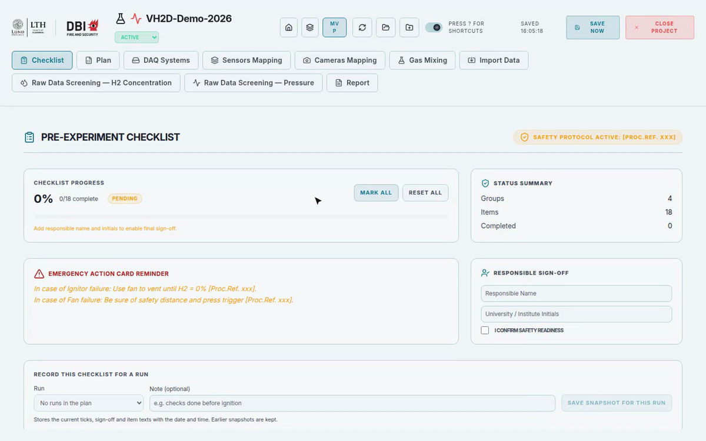

---

## 2. Before you start

**Start EXDA** with the launcher for your computer (see [RUN_EXDA.md](../../RUN_EXDA.md)):
`Run-EXDA-WIN.bat` (Windows), `Run-EXDA-MAC.command` (macOS) or
`Run-EXDA-LINUX.sh` (Linux). The launcher checks the requirements, starts EXDA and
opens it in your web browser.

**Keep your projects outside the EXDA app folder.** Use a separate folder, for
example `EXDA-Projects` next to the app folder. App updates then never touch your
experiment records.

**One project folder per campaign.** EXDA creates this structure for you:

```text
EXDA-Projects/
└── <Project>/
    ├── Plan/          the experiment plan
    ├── Raw_Data/      instrument files, one folder per run: Raw_Data/<run>/<DAQ>/
    ├── Clean_Data/    processed data
    ├── CFD_Data/      simulation data
    ├── Reports/       mappings, gas mixing, checklists and exported reports
    ├── Literature/    papers for the project
    └── History/       earlier versions of every saved file and a change log
```

**Open each project in one window only.** A second window on the same project is
read-only (see [section 13](#13-how-exda-protects-your-data)).

---

## 3. Create a project

1. On the Home page, click **Create Project**.
2. In **Current folder**, type or browse to your projects folder (for example
   `EXDA-Projects`) and press Enter.
3. Type the **Project name** and click **Create**.

The project opens on the Checklist tab, with all folders created.

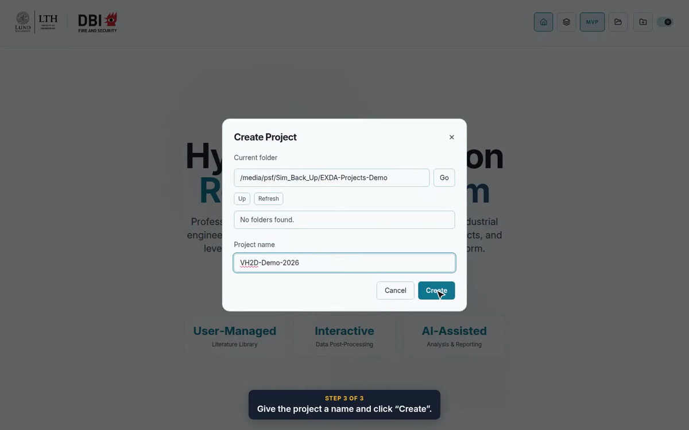

▶ **Video:** [Create a project](videos/01-create-project.mp4) (22 s)

---

## 4. Open an existing project

1. On the Home page, click **Open Project**.
2. Go to your projects folder, click the project folder, then click **Open**.

Projects you used recently are also listed on the Home page under
**Recent Projects**, each with its own **Open** button. Click **Close Project**
(top right) when you are finished; EXDA asks whether to save first.

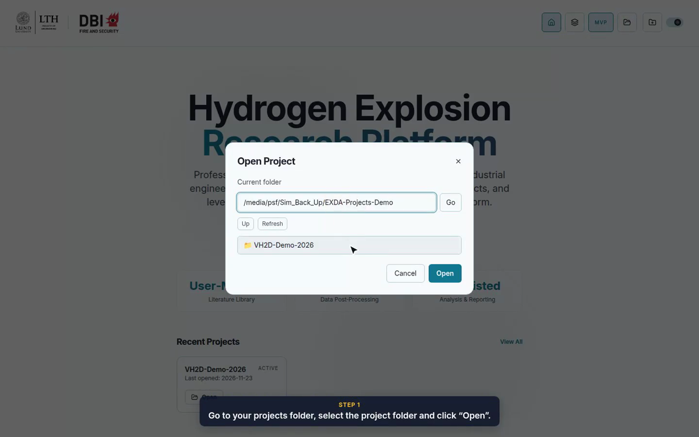

▶ **Video:** [Open a project](videos/10-open-project.mp4) (19 s)

---

## 5. Plan the campaign

Open the **Plan** tab.

1. Write the campaign **Objective** (one line) and, if useful, a longer
   description, start date and deadline.
2. Add a run: **Group ID** (e.g. `VH2D-G01`), **Run #** (e.g. `1`, or `1-R1` for a
   repeat), **H2 vol.%** and the planned date. The run name is built from these
   (here `VH2D-G01-01`); you can override it.
3. Click **Add Planned Run**. Repeat for every run.
4. Click **Sync run folders**. This creates `Raw_Data/<run>/` for every run; that is
   where the instrument files of the run go.
5. Click the **pen icon** on a run card to add details: ignition position, vent,
   notes, status flags (done, error, cancelled) and, after the test, the actual
   ignition time. Click **Save Run Card**.

Initial pressure and temperature (P0, T0) are shown on the run card but are entered
in **Gas Mixing**, where they are measured.

**Renaming a group** (Apply Group Rename) also renames the run folders on disk.
EXDA first lists every folder that will be moved and asks you to confirm; runs
already marked done need a second confirmation. Either all folders are renamed or
none.

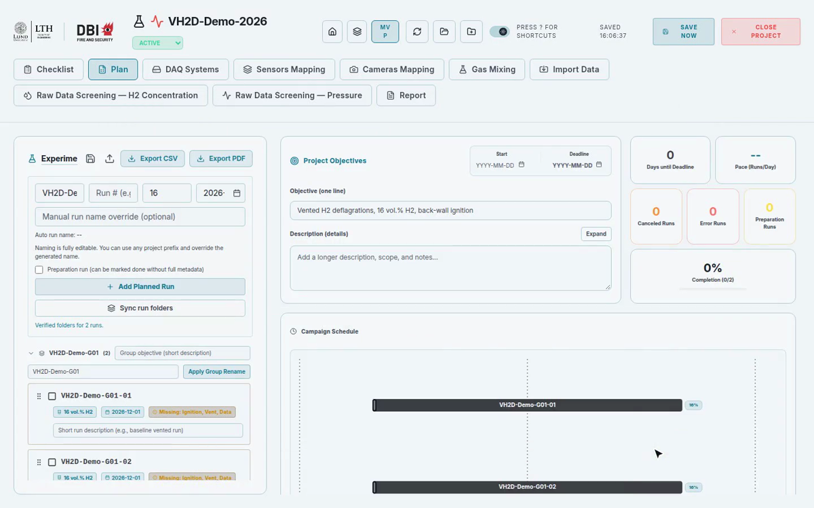

▶ **Video:** [Plan the campaign and add runs](videos/02-plan-and-runs.mp4) (48 s)

---

## 6. Pre-experiment checklist

The **Checklist** tab holds the safety and pre-test checks.

1. Tick each check as it is completed, or use **Mark All** / **Mark Group**.
2. Sign off: **Responsible Name**, **University / Institute Initials**, and tick
   **I confirm safety readiness**.
3. Under **Record this checklist for a run**, choose the run, add a note if useful,
   and click **Save snapshot for this run**.

Each snapshot stores the date and time (with time zone), every tick, the item
texts and the sign-off. Earlier snapshots are listed per run and are never
overwritten, so the checks done before each test stay on record.

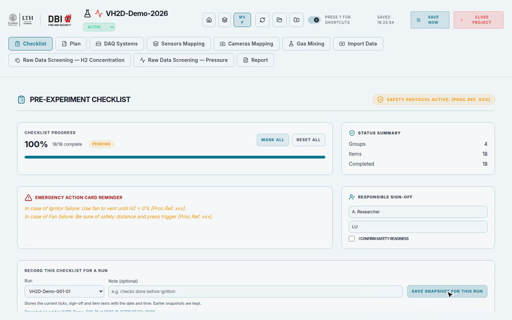

▶ **Video:** [Checklist and per-run snapshot](videos/03-checklist.mp4) (33 s)

---

## 7. DAQ systems

In **DAQ Systems**, click **Add DAQ**, fill in name, model, serial number, sampling
rate, channel count and calibration details, and click **Save DAQ**. The list can
be exported as CSV or PDF.

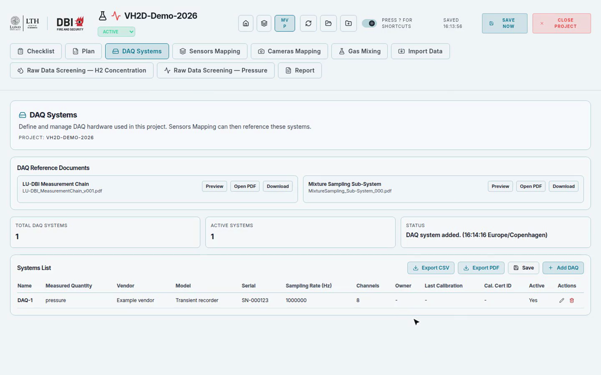

▶ **Video:** [Add a DAQ system](videos/04-daq-systems.mp4) (33 s)

---

## 8. Sensors and cameras mapping

In **Sensors Mapping**:

1. Click **Generate from Plan**. This creates one mapping for each run group of the
   plan.
2. Click **Add Sensor** and fill in the sensor: ID, measured quantity, DAQ system
   and channel, serial number, sensitivity and unit, location, coordinates and
   mounting. Click **Save Sensor**.
3. EXDA checks the fields against the sensor type, for example: a trigger channel
   is a voltage and has no sensitivity; a concentration sensor cannot have a
   pressure unit such as pC/bar; two active sensors at the same coordinates are
   flagged.

**When a run used a different setup** (a probe missing, a sensor moved, a cable
swapped), open **Per-run overrides**, choose the run and click
**Create / open run override**. The run gets its own copy of the group mapping;
change only what differs. The table shows which mapping each run uses.

**Cameras Mapping** works the same way (**Add Camera**).

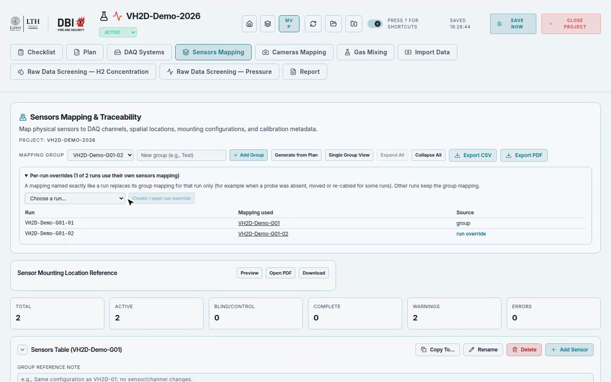

▶ **Video:** [Sensors mapping and per-run override](videos/05-sensors-mapping.mp4) (56 s)

---

## 9. Gas mixing

In **Gas Mixing**:

1. Choose the **Campaign Group** and the **Run / Test**.
2. Enter the measured values: relative humidity, MFC setpoint, chamber pressure
   (choose its unit: Pa, hPa, kPa or bar), chamber temperature, chamber dimensions
   and the volume corrections. Nothing is filled in for you: a missing value stays
   missing, and EXDA refuses to calculate without it.
3. Click **Calculate**.
4. Click **Save Run**.

If you change an input after calculating, the result is marked **STALE** and
cannot be saved until you calculate again, so a saved record always matches its
inputs. Older records are shown **as saved**, with the calibration they were saved
with.

**Check records** lists inconsistencies in the saved records (for example a
missing humidity, or a pressure of exactly 101325 Pa that looks like a default).
It never changes the records; you can download the list as CSV.

Every saved change keeps the earlier version of the record.

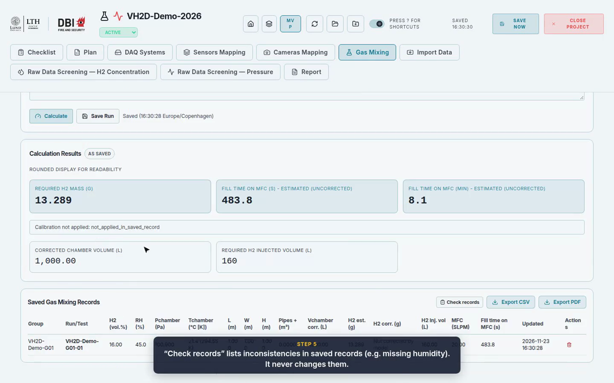

▶ **Video:** [Gas mixing: calculate, save, check records](videos/06-gas-mixing.mp4) (42 s)

---

## 10. Import and screen the measured data

1. After the test, copy the instrument files into the run folder:
   `Raw_Data/<run>/<DAQ>/` (for example `Raw_Data/VH2D-G01-01/DAQ-1/`).
2. Open **Import Data** and click **Select Import Folder**, then **Use Folder**.
   EXDA reports how many files it found; click **Close**.
3. In **Pressure Data** choose the pressure file(s) of the run; in
   **Concentration Measurements** the H2 file(s).
4. Open **Raw Data Screening — Pressure** to look at the channels, and
   **Raw Data Screening — H2 Concentration** for the H2 signals.

Good to know:

- **Units come from the file.** Channels stored in bar or Pa are converted to kPa
  only as a unit change; a trigger channel in V stays in V.
- **H2 sensor (H2S) logs** that contain several recordings show a
  **Recording in this file** selector. Recordings are never joined. A recording
  that is identical to one in another run's file is pointed out.
- **BGA concentration** values are in ppm; tick *Convert ppm to vol.%* to show
  vol.%.
- Screening reduces long signals for display. It is a quick look, not the
  analysis.

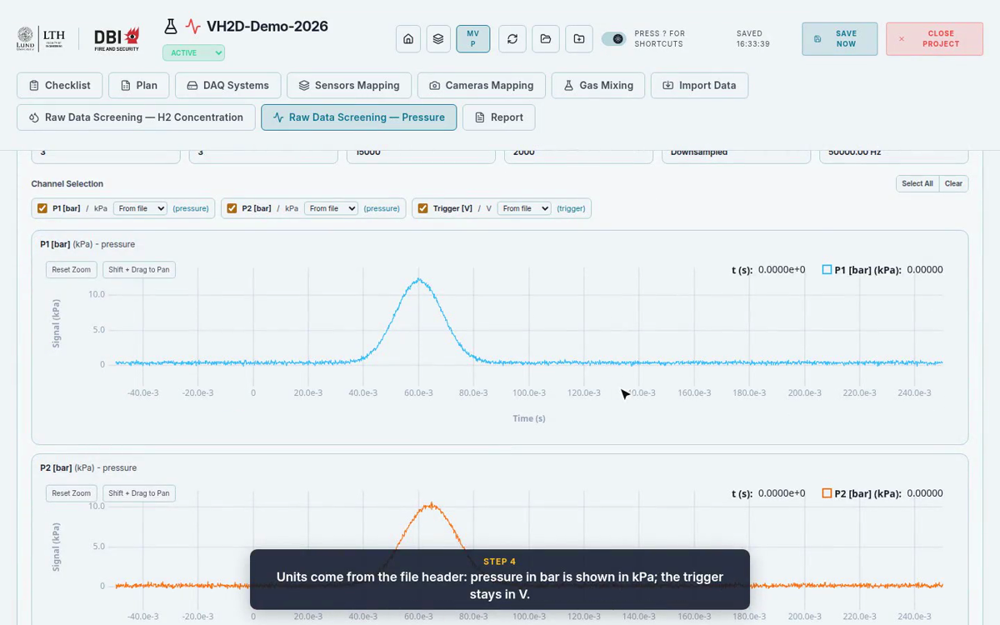

▶ **Video:** [Import and screen the data](videos/07-import-and-screen-data.mp4) (46 s)

---

## 11. Record the actual ignition time

The plan holds planned dates; the actual firing time belongs on the run card.

1. In **Plan**, open the run card (pen icon).
2. Click **Suggest from instrument files**. EXDA lists the time stamps found in the
   run's files, each with its source and time zone (for example the start of an MF4
   recording, or the last BGA log entry).
3. Click **Use** next to the stamp that matches the ignition, or type the logbook
   time yourself, **with the time zone** (e.g. `2026-07-02T18:50:35+02:00`).
4. Click **Save Run Card**.

Nothing is filled in automatically. Some stamps are only hints: a DAQ start time
can be the same for several runs of one session.

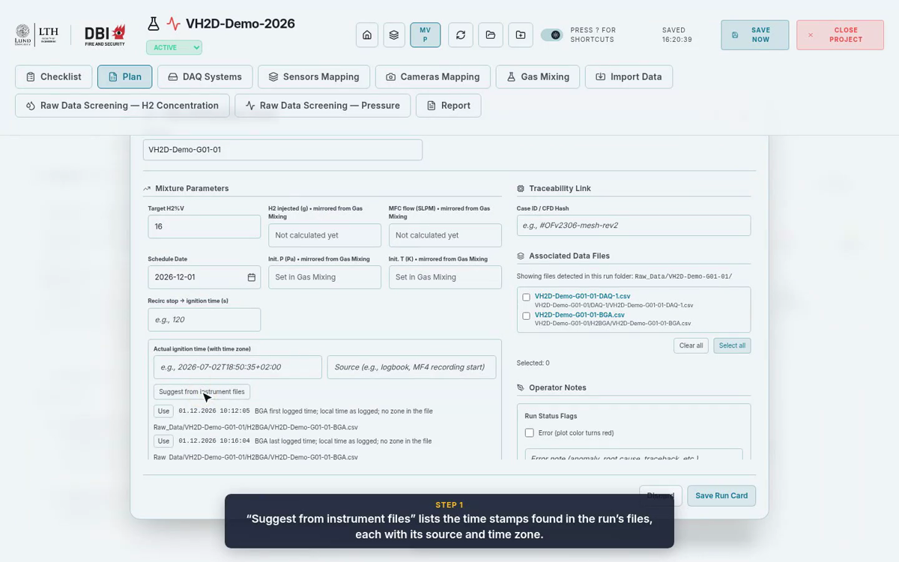

▶ **Video:** [Record the actual ignition time](videos/09-actual-ignition-time.mp4) (26 s)

---

## 12. Export the report

Open **Report** and click **Export PDF** or **Export CSV**. The metadata report
combines plan, DAQ systems, sensors and cameras mapping and gas mixing.

Reports are saved in the project's `Reports/` folder with the date **and time** in
the file name (e.g. `…_Metadata_Report_2026-12-01_143205.pdf`), so an earlier
report is never overwritten. Plan, DAQ, mapping and gas mixing tables can also be
exported from their own tabs.

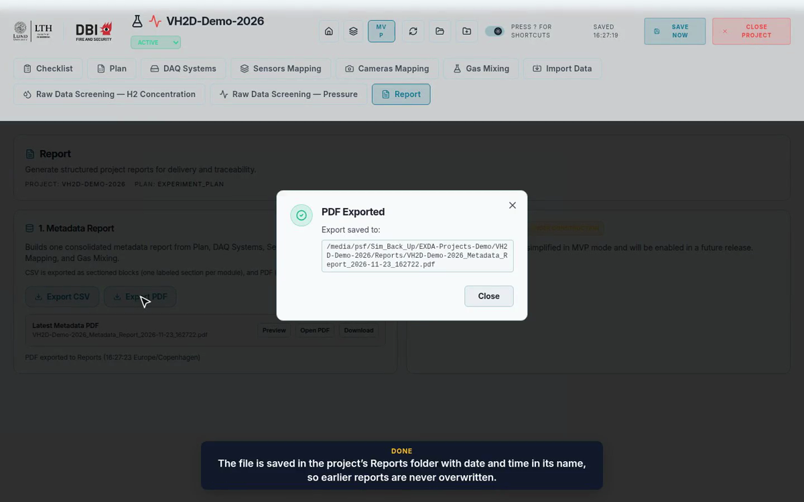

▶ **Video:** [Export the report](videos/08-report.mp4) (19 s)

---

## 13. How EXDA protects your data

- **Raw data is only read.** EXDA never changes the instrument files.
- **Earlier versions are kept.** Before a project file changes, the previous
  version is copied to `History/` and the change (who, when, which field,
  old → new) is written to `History/change_log.jsonl`. The version saved on the
  test day can always be retrieved.
- **Safe saving.** Files are written so that a crash or power cut leaves either
  the old or the new version, never a broken file.
- **One editor per project.** While a project is open for editing in one window
  (on any computer), every other window shows **Read-only** and saves nothing. When
  the first window is closed, the other one can edit after about 30 seconds;
  reload it first. **Take over editing** is only for when the other EXDA crashed.
- **No silent overwrites.** If a file was changed elsewhere after you opened it,
  your save is refused with *“changed elsewhere … reload”* instead of overwriting
  the other change.
- **No silent defaults.** Missing measured values stay missing; EXDA tells you
  instead of guessing.

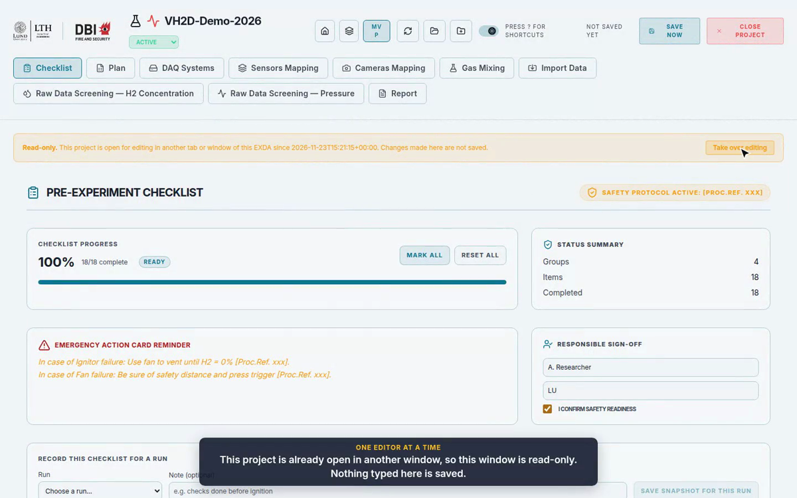

▶ **Video:** [What a second window shows](videos/11-read-only-second-window.mp4) (14 s)

---

## 14. Troubleshooting

| Message or symptom | What to do |
|---|---|
| **Read-only** banner | The project is open in another window or on another computer. Close that one and reload this one. Use **Take over editing** only if the other EXDA crashed. |
| *“… was changed elsewhere … reload”* | Someone saved the same file after you opened it. Reload the page, then redo your change. |
| Gas Mixing result marked **STALE** | An input changed after calculating. Click **Calculate** again, then **Save Run**. |
| *“Missing required input …”* in Gas Mixing | Enter the missing measured value; EXDA does not substitute a default. |
| H2S file: *“contains 2 recordings; choose one”* | Choose the recording in **Recording in this file**. |
| A file does not appear in Import Data | Check that it is inside `Raw_Data/<run>/` and has a supported type: csv, txt, dat, asc, mf4, tpc5. |
| The project you expect does not open | Check that you are opening it from your projects folder (e.g. `EXDA-Projects`), not from an old copy. |

The detailed review behind version 4.0.0 is in [EXDA-Check.md](../EXDA-Developer-Overview/EXDA-Check.md).
