# EXDA User Guide — MVP mode (version 5.0.5)

This guide walks you through a test campaign in EXDA, tab by tab, in the order
you use them: from opening a project to exporting the report. Every section has a
screenshot and a short video (5–20 s, no sound) that shows where to click. The
videos are MP4 files in `docs/EXDA-User-Guide/videos/`; open them with any video
player.

> The screenshots and videos use demo projects with **synthetic example data**.
> Your screens show your own project names, runs and values.

---

## Contents

1. [What MVP mode is](#1-what-mvp-mode-is)
2. [Start EXDA](#2-start-exda)
3. [Projects: open, create and find them](#3-projects-open-create-and-find-them)
4. [Project Description](#4-project-description)
5. [Checklist and safety procedures](#5-checklist-and-safety-procedures)
6. [Plan](#6-plan)
7. [DAQ Systems](#7-daq-systems)
8. [Sensors and Cameras Mapping](#8-sensors-and-cameras-mapping)
9. [Gas Mixing](#9-gas-mixing)
10. [Import Data](#10-import-data)
11. [Raw Data Screening — Pressure](#11-raw-data-screening--pressure)
12. [Raw Data Screening — H2 Concentration](#12-raw-data-screening--h2-concentration)
13. [Record the actual ignition time](#13-record-the-actual-ignition-time)
14. [Report](#14-report)
15. [How EXDA protects your data](#15-how-exda-protects-your-data)
16. [Troubleshooting](#16-troubleshooting)

---

## 1. What MVP mode is

MVP (minimum viable product) mode is EXDA for test days: a fast check, after each
run, of whether the run is OK or must be repeated. Detailed analysis for reports
and papers is done elsewhere (for example in MATLAB). MVP mode shows only the tabs
needed to prepare, run and document a campaign, in this order:

| Tab | What it is for |
| --- | --- |
| **Project Description** | What the project is: objective, dates, and standard fields that describe it the same way in every project |
| **Checklist** | Safety and pre-test checks, signed off, and the project's safety procedures |
| **Plan** | The runs of the campaign, their status and details |
| **DAQ Systems** | The data acquisition systems used |
| **Sensors Mapping** / **Cameras Mapping** | Where each sensor and camera is and how it is connected |
| **Gas Mixing** | Hydrogen fill calculation for each run |
| **Import Data** | Selecting the instrument files of a run |
| **Raw Data Screening — Pressure** | A quick look at the pressure signals, with peak pressures in a time range |
| **Raw Data Screening — H2 Concentration** | A quick look at the measured hydrogen concentration |
| **Report** | The metadata report of the campaign (PDF or CSV) |

The **MVP** button in the top bar switches MVP mode on and off; switching it off
can be protected with a password set by whoever installed EXDA. With MVP mode off,
the advanced analysis tabs (pressure analysis, EWT, CFD validation, flame speed,
AiRA, literature) appear as well.


**Development and AI assistance.** EXDA was designed and developed by Javier I.
Camacho. The code and the documentation, including this guide, were written with
the assistance of AI coding tools (OpenAI Codex and Anthropic Claude, including
Claude Opus 5.5). All changes were reviewed by the author. The calculations are
covered by automated tests; the Developer Overview lists what has been verified
against independent references and what has not. Results shown by EXDA are for
quick on-site checks and are not final, publication-grade results.

---

## 2. Start EXDA

**Get EXDA once.** Make a folder called `EXDA` in a local place, for example
`C:\EXDA` or `~/EXDA` (not OneDrive, iCloud Drive, Dropbox or Google Drive), and
put the app inside it:

```bash
mkdir EXDA
cd EXDA
git clone https://github.com/jcam77/EXDA-dashboard.git
```

Without git, download the ZIP from GitHub (**Code → Download ZIP**) and unzip it
inside the `EXDA` folder. After the first start the folder holds three things:

```text
EXDA/
├── EXDA                ← shortcut: double-click to start EXDA
├── EXDA-dashboard/     ← the app (everything EXDA installs is in here)
└── EXDA-Projects/      ← your projects (created by EXDA)
```

**Double-click EXDA.**

- **Windows:** `Run-EXDA-WIN.bat` in the app folder the first time. After that,
  use the **EXDA** shortcut in the `EXDA` folder or in the Start menu. The first
  start asks whether you also want it on the Desktop.
- **macOS:** `EXDA.app` in the app folder the first time. After that, use the
  **EXDA** shortcut in the `EXDA` folder.
- **Linux:** run `Setup-EXDA-LINUX.sh` once, then `Run-EXDA-LINUX.sh`.

**The first start installs what EXDA needs** (a few minutes, internet needed,
about 1–2 GB). The Python packages go into `.venv-win`, `.venv-mac` or `.venv`
and the frontend packages into `node_modules`, both inside the app folder, and
the setup window prints these paths. Nothing else is added to your computer
apart from the shortcuts listed above. Only if Node.js or Python is missing does
EXDA offer to install it for the whole computer (Windows: `winget`, macOS:
Homebrew), and only after you accept. Otherwise it opens the download page.
Every later start only runs a quick check (about two seconds) and opens EXDA in
your web browser. Close the terminal window to stop EXDA.

**Your projects are kept apart from the app,** in `EXDA-Projects` next to it.
App updates never touch them. You can also open projects stored anywhere else,
for example on a lab drive.

**To update EXDA or remove it,** replace or delete only the app folder:

1. Close EXDA (close its terminal window).
2. Delete the app folder `EXDA-dashboard`. **Do not delete the EXDA folder
   around it**, because that holds your projects.
3. For a newer version, put the new app folder in the same `EXDA` folder and
   double-click its launcher. The first start installs the packages again (a few
   minutes) and updates the EXDA shortcuts.
4. To remove EXDA completely, also delete the EXDA shortcuts: in the `EXDA`
   folder and, on Windows, in the Start menu and on the Desktop.

If the Projects page shows a warning **Projects inside the app folder**, your
projects are stored in an older place that an update would delete. Close EXDA,
move them to `EXDA-Projects` as the warning says, and start EXDA again.

Node.js and Python stay on the computer, which is what the next version needs.
To remove them as well, uninstall them like any other program, but only if no
other software uses them. If you got EXDA with `git clone`, updating with
`git pull` in the app folder is quicker: the packages stay, and the next start
installs only what changed.

**Open each project in one window only.** A second window on the same project is
read-only (see [section 15](#15-how-exda-protects-your-data)).

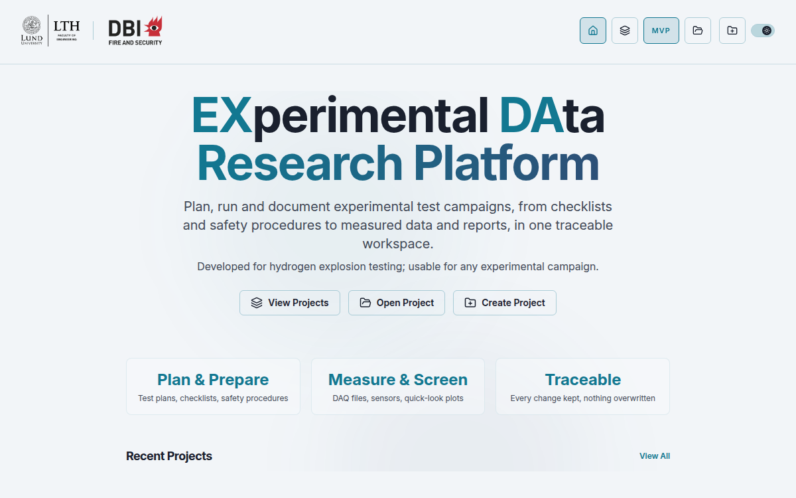

---

## 3. Projects: open, create and find them

**Open a project.** On the Home page, click **Open Project**.

1. The window opens in your projects folder (`EXDA-Projects`, or the projects
   folder of the project you opened last). The path at the top shows where you
   are; click any part of it to go back.
   The buttons below it jump to **EXDA projects**, Home, Desktop, Documents and
   your drives. To type or paste a path, click the pen icon.
2. **Click** a folder to select it, **double-click** (or click **›**) to go
   inside. EXDA projects are marked **PROJECT**.
3. Select the project and click **Open**.

The project opens on the **Project Description** tab. Projects you used recently
are also on the Home page under **Recent Projects**. Click **Close Project** (top
right) when you are finished.

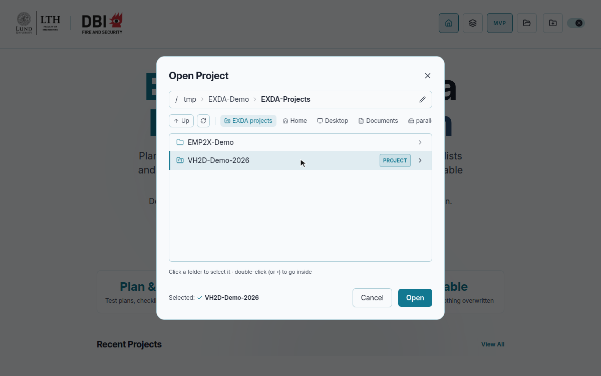

▶ **Video:** [Open a project](videos/01-open-project.mp4) (9 s)

**Create a project.** On the Home page, click **Create Project**, go to your
projects folder, type the **Project name** and click **Create**. EXDA creates the
project's folders:

```text
EXDA-Projects/
└── <Project>/
    ├── exda-project.json   marks the folder as an EXDA project (keep it)
    ├── Plan/               the experiment plan and the project description
    ├── Raw_Data/           instrument files, one folder per run: Raw_Data/<run>/<DAQ>/
    ├── Clean_Data/         processed data
    ├── CFD_Data/           simulation data
    ├── Reports/            mappings, gas mixing, checklist and exported reports
    ├── Literature/         papers for the project
    ├── Procedures/         RAMS, RAMS appendices and SOPs for the campaign
    └── History/            earlier versions of every saved file and a change log
```

Opening a folder that is not an EXDA project never turns it into one silently:
EXDA asks first whether to create the project folders there.

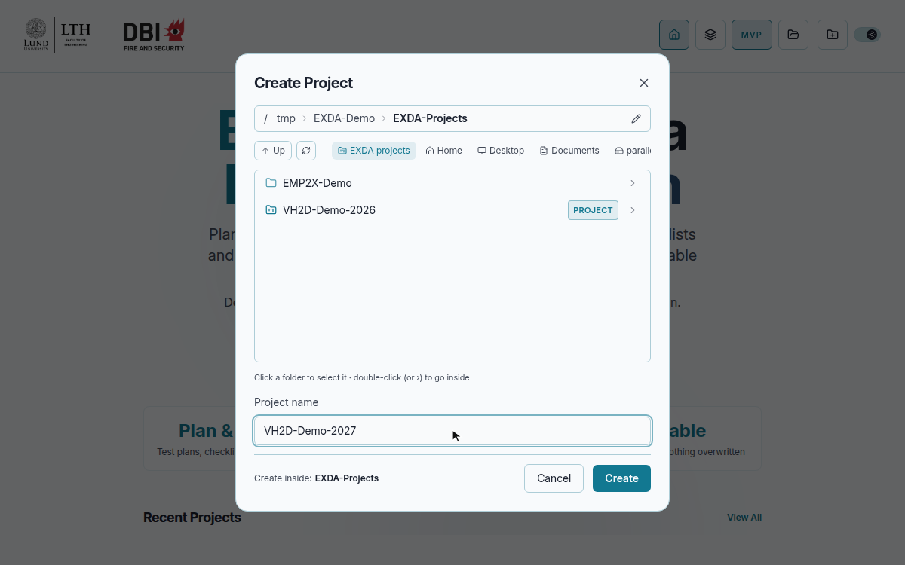

▶ **Video:** [Create a project](videos/02-create-project.mp4) (11 s)

**Find your projects.** The **Projects** page (layers icon in the top bar) lists
all projects in your projects folder. Projects that belong together can sit in a
common folder, for example several campaigns of one larger project; they are shown
together in one block with the folder name. Click the block's header to fold it to
one line; EXDA remembers which blocks are folded. The search finds projects by
name, objective and the fields of their Project Description (methods, facility,
keywords, …). **Clear All** empties the folder list until you add a folder with
**Add Projects Root**.

**Research and experimental capabilities.** The card under the summary shows
the terms from the Project Description of the projects listed: methods, measured
quantities, technical skills, facility, fuels and keywords. The more projects use a term, the larger
it is, and each kind of term has its own colour (see the line above the words).
Hold the mouse over a word to highlight it and see which projects use it; click
it to find those projects. While a word or a search is active, a bar above the
list says how many projects are shown (for example *Showing 1 of 3 projects
matching "flame arrival"*); click **Show all**, the **×** in the search box, the
word again or **Filter: … ×** in the card to see all projects again. The card follows the folder and
status you select, so you can compare, for example, only your real projects with
the demo projects left out. It is empty until the projects have a Project
Description (see [section 4](#4-project-description)). Click its header to fold it.

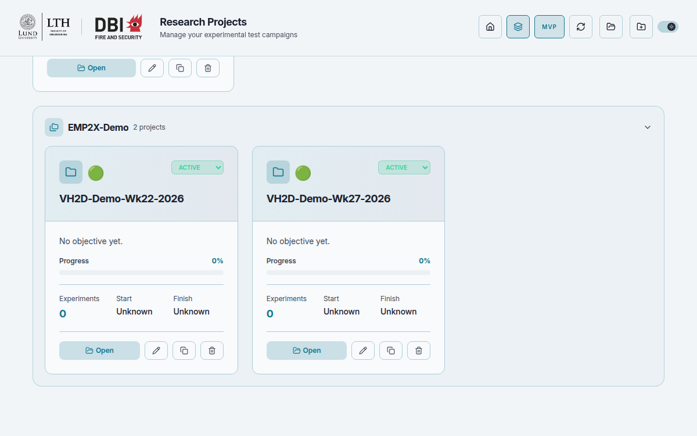

▶ **Video:** [Projects page: capabilities, groups and search](videos/02-projects-page.mp4) (9 s)

---

## 4. Project Description

The first tab says what the project is.

**Project Objectives** (top): the one-line objective, a longer description, start
date and deadline. They are saved automatically with the experiment plan.

**Standard fields** are the same in every project, so projects can be compared:
research questions, methods, measured quantities, technical skills, facility /
rig, fuels / mixtures, scale & conditions, partners / funding and keywords. Leave a
field empty if it does not apply. The terms in methods, measured quantities,
technical skills, facility, fuels and keywords make up the **research and experimental capabilities** card on the
Projects page (see [section 3](#3-projects-open-create-and-find-them)).

- In term fields, type a term and press **Enter** (or comma). While you type, EXDA
  suggests terms already used in your other projects and shows in how many; pick
  one with the arrow keys and **Enter**, or click it. A typed term that matches a
  known one takes its spelling, so the same thing has the same name everywhere.
- **Backspace** in an empty term field removes the last term; **×** removes one.

**Technical skills** are the skills the project needs, for example DAQ setup, CFD
(OpenFOAM) or 3D CAD design. To keep the same name for the same skill in every
project, they are picked from the **team's skills list**, grouped by category:
type part of a name or category (for example *imag* or *CAD*) and pick a skill.

- **A skill is missing?** Type it and click **Add "…" to the team's skills list**,
  check the name, choose its category (or a new one) and click **Add and use**.
  It is then in the list for everyone, with who added it and when. First check
  that it is not already there under another name.
- The list is shared by all projects in your projects folder and is stored in
  `EXDA-Projects/exda-skills.json`. EXDA never removes skills from it.
- A skill shown in orange with a warning sign is not in your team's list, for
  example in a project from another team. It is kept as it is.

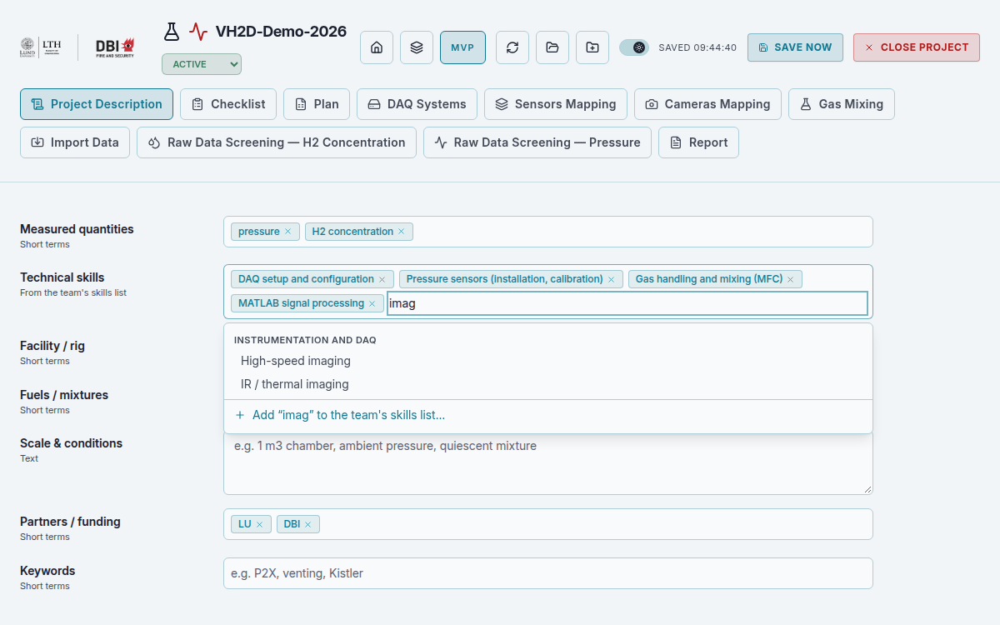

**Extra fields** are for things only this project needs (for example the vent
configuration or the ignition source): click **Add field**, give it a name and a
value. They are kept but not used to compare projects.

Changes are saved automatically about a second after you stop typing; the status
at the top shows *Saving…* and *All changes saved*. **Save Now** in the top bar
saves them too. The description is stored in `Plan/project_description.json`.

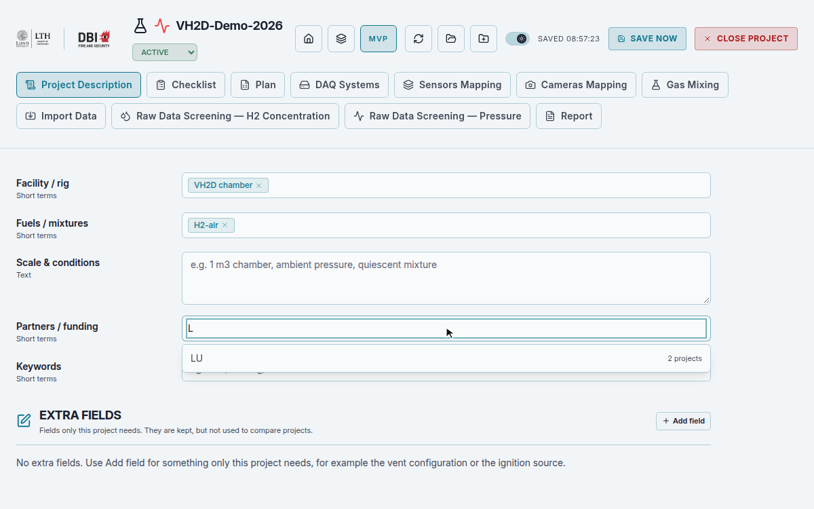

▶ **Video:** [Describe the project](videos/03-project-description.mp4) (17 s)

---

## 5. Checklist and safety procedures

The **Checklist** tab holds the safety and pre-test checks.

1. Tick each check as it is completed, or use **Mark All** / **Mark Group**.
2. Sign off: **Responsible Name**, **University / Institute Initials**, and tick
   **I confirm safety readiness**.

Record anything unusual for a run (a check that could not be done, a deviation)
in that run's notes on its run card in **Plan**.

**Edit the checklist.** Each project has its own checklist. Click **Edit
checklist** to rename groups, add, change, move or delete checks, or add a group.
Nothing is saved until you click **Save checklist**; **Cancel** undoes everything.
A renamed or moved check keeps its tick; EXDA asks before checks are removed.

**Safety Procedures** at the bottom of the tab lists the documents in the
project's `Procedures/` folder (RAMS, appendices, SOPs) with **Preview**,
**Open PDF** and **Download**. The badge at the top shows how many there are, or
warns when RAMS or SOPs are missing; click it to jump to the list.

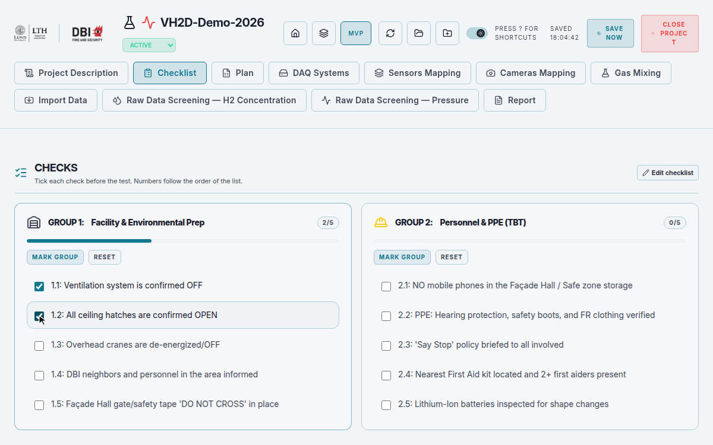

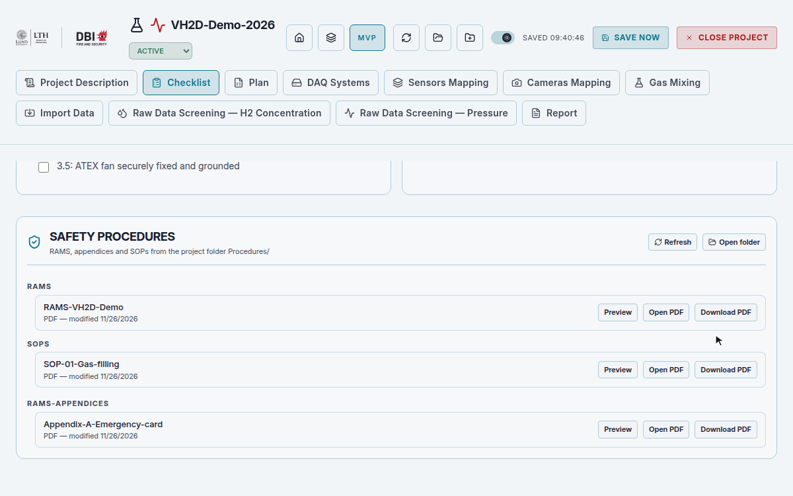

▶ **Video:** [Checklist and safety procedures](videos/04-checklist.mp4) (15 s)

---

## 6. Plan

The **Plan** tab holds the runs of the campaign. The objective, description and
dates are in **Project Description**.

1. Add a run: **Group ID** (e.g. `VH2D-G01`), **Run #** (e.g. `1`, or `1-R1` for a
   repeat), **H2 vol.%** and the planned date. The run name is built from these
   (here `VH2D-G01-01`); you can override it.
2. Click **Add Planned Run**. Repeat for every run.
3. Click **Sync run folders**. This creates `Raw_Data/<run>/` for every run; that
   is where the instrument files of the run go.
4. Click the **pen icon** on a run to open its **run card**: ignition position,
   vent, notes, the data files of the run, status flags (done, error, cancelled)
   and, after the test, the actual ignition time. Click **Save Run Card**.

The figures at the top show days until the deadline, pace, cancelled, error and
preparation runs, and completion. Initial pressure and temperature (P0, T0) are
shown on the run card but are entered in **Gas Mixing**, where they are measured.

**Renaming a group** (Apply Group Rename) also renames the run folders on disk.
EXDA first lists every folder that will be moved and asks you to confirm; either
all folders are renamed or none.

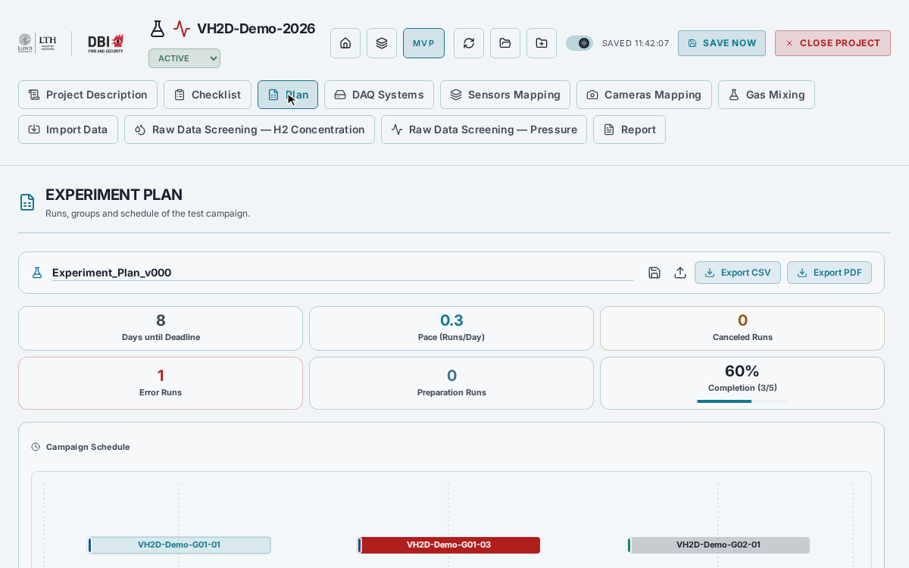

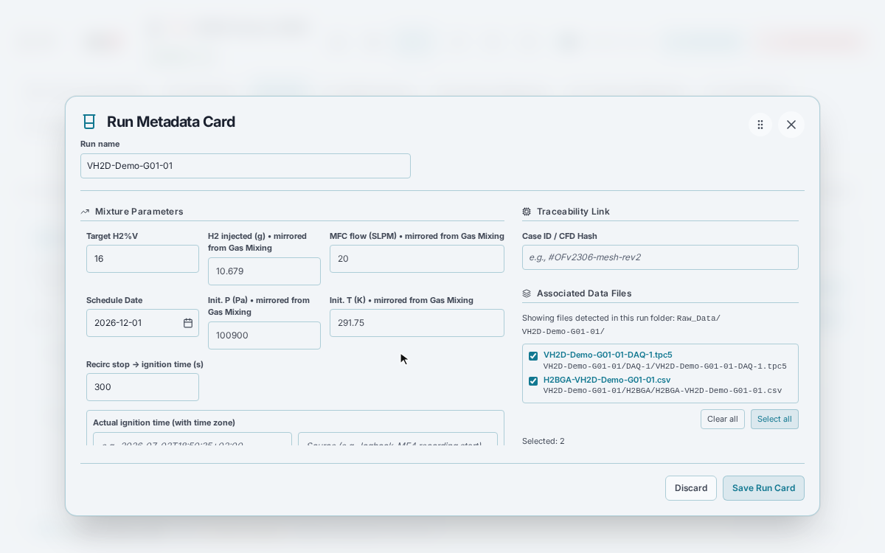

▶ **Video:** [Add a run and open its run card](videos/05-plan.mp4) (15 s)

---

## 7. DAQ Systems

In **DAQ Systems**, click **Add DAQ**, fill in name, measured quantity, vendor,
model, serial number, sampling rate, channel count and calibration details, and
click **Save DAQ**. The list can be exported as CSV or PDF, and reference
documents (for example the measurement chain) can be previewed or downloaded.

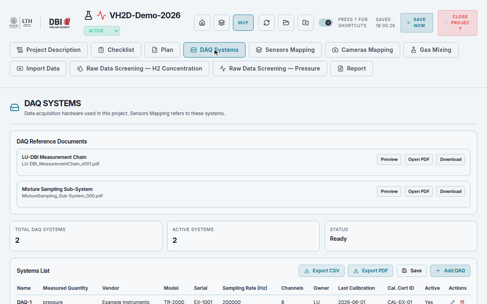

▶ **Video:** [Add a DAQ system](videos/06-daq-systems.mp4) (14 s)

---

## 8. Sensors and Cameras Mapping

In **Sensors Mapping**:

1. Click **Generate from Plan**. This creates one mapping for each run group of
   the plan.
2. Click **Add Sensor** and fill in the sensor: ID, measured quantity, DAQ system
   and channel, serial number, sensitivity and unit, location, coordinates and
   mounting. Click **Save Sensor**.
3. EXDA checks the fields against the sensor type, for example: a trigger channel
   is a voltage and has no sensitivity; a concentration sensor cannot have a
   pressure unit such as pC/bar; two active sensors at the same coordinates are
   flagged.

**When a run used a different setup** (a probe missing, a sensor moved, a cable
swapped), open **Per-run overrides**, choose the run and click
**Create / open run override**. The run gets its own copy of the group mapping;
change only what differs. The table shows which mapping each run uses.

**Cameras Mapping** works the same way (**Add Camera**).

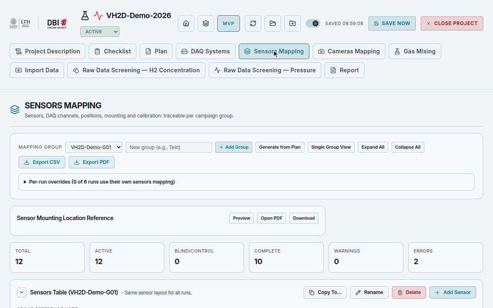

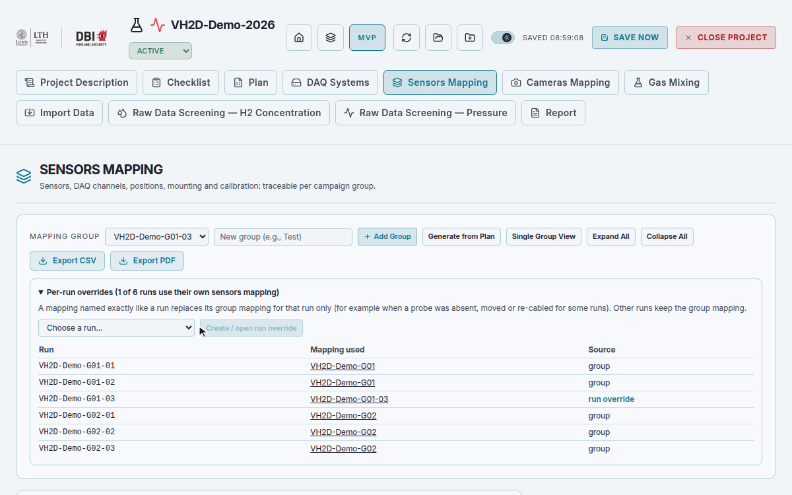

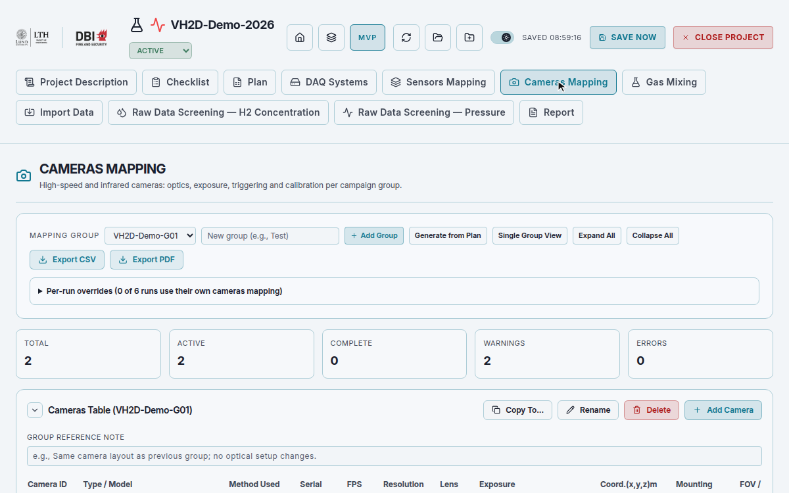

▶ **Video:** [Sensors mapping and a per-run override](videos/07-sensors-mapping.mp4) (10 s)

---

## 9. Gas Mixing

In **Gas Mixing**:

1. Choose the **Campaign Group** and the **Run / Test**.
2. Enter the measured values: relative humidity, MFC setpoint, chamber pressure
   (choose its unit: Pa, hPa, kPa or bar) and chamber temperature. These stay
   empty until you enter them, and EXDA refuses to calculate without them.
3. Click **Calculate**.
4. Click **Save Run**.

> **Check the chamber values of a new run.** For a run without a saved record, the
> chamber dimensions start at 0.9 × 0.9 × 0.9 m and the volume corrections
> (pipes, hotwire assembly, welded parts, bolts) at 0. Enter your chamber's
> values, in particular the **pipes volume**: a wrong volume gives a wrong H2
> mass and injection time without any warning. Also check the **MFC standard
> conditions** (shown under *Standards & constants*, default 25 °C / 101 325 Pa)
> against the calibration of your MFC.

If you change an input after calculating, the result is marked **STALE** and
cannot be saved until you calculate again, so a saved record always matches its
inputs. **Check records** lists inconsistencies in the saved records (for example
a missing humidity, or a pressure of exactly 101 325 Pa that looks like a
default); it never changes the records. Every saved change keeps the earlier
version of the record.

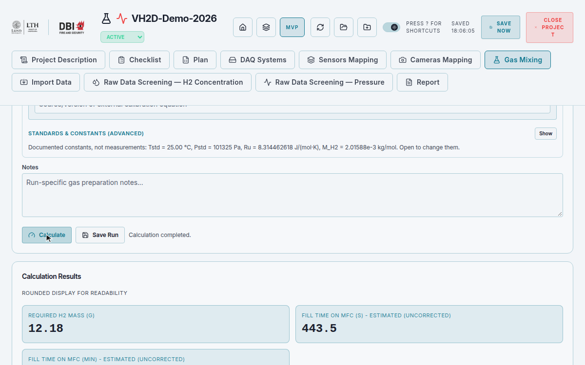

▶ **Video:** [Gas mixing: enter, calculate, save](videos/08-gas-mixing.mp4) (15 s)

---

## 10. Import Data

1. After the test, copy the instrument files into the run folder:
   `Raw_Data/<run>/<DAQ>/` (for example `Raw_Data/VH2D-G01-01/DAQ-1/`).
2. Open **Import Data** and click **Select Import Folder**. Select the run's
   folder and click **Use Folder**. EXDA reports how many files it found; click
   **Close**.
3. In **Pressure Data** choose the pressure file(s) of the run; in
   **Concentration Measurements** the H2 file(s).

Supported file types: csv, txt, dat, asc, mf4 and tpc5.

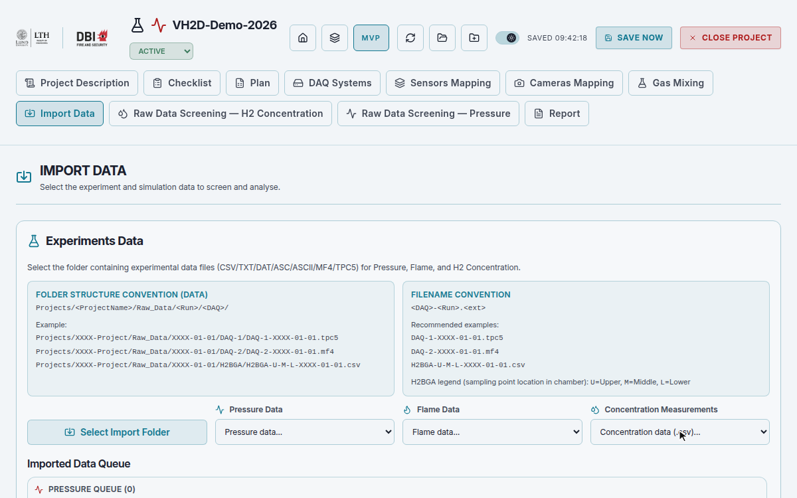

▶ **Video:** [Import the files of a run](videos/09-import-data.mp4) (12 s)

---

## 11. Raw Data Screening — Pressure

This tab is the quick look after a run: are the signals there, is anything
clipped, and what are the peak pressures?

**The plot.** Choose the file and the channels to show. For speed, long recordings
are shown in reduced form: the signal is split into short intervals and every
interval keeps its lowest and highest sample per channel, so **peaks and clipping
are always visible**. The tiles above the plot show the real number of samples in
the file, how many are drawn, and the real sampling rate. For the exact waveform
between those points, tick **Full Resolution** or set a time window.

- **Units come from the file.** Channels stored in bar or Pa are converted to kPa
  only as a unit change (tick or untick *Convert pressure to kPa*); a trigger
  channel in V stays in V. A channel's unit can be changed by hand if the file has
  none.

**Peak pressures.** Under the plot, set the time range of the event (**Start** and
**End**, in s) and click **Calculate peaks**. The range is shaded in the plot.

- The table shows, for each ticked channel, the **maximum** and the **time of the
  maximum** inside the range, calculated from **every sample** of the file (not
  from the reduced plot), on the raw values: no filter, no baseline correction.
- A time range is required. The maximum over the whole recording would often be a
  late-time disturbance, not the event: in the demo run, channel P5 has an
  electrical spike at 1.25 s that is 14 times higher than its real peak.
- Pressure channels are ticked, trigger and voltage channels are not; change the
  ticks as needed. Values are shown in the plot's unit, with a note when the file
  recorded another unit (*recorded in bar*).
- If you change the range or the ticks, the values are cleared until you click
  **Calculate peaks** again.
- The table is for the screen only; nothing is written to the project.

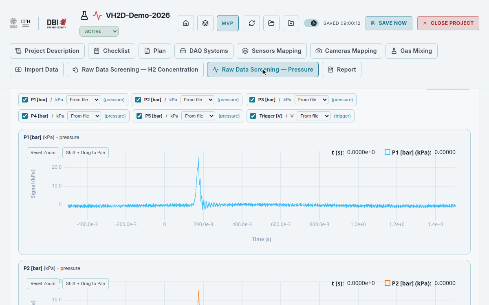

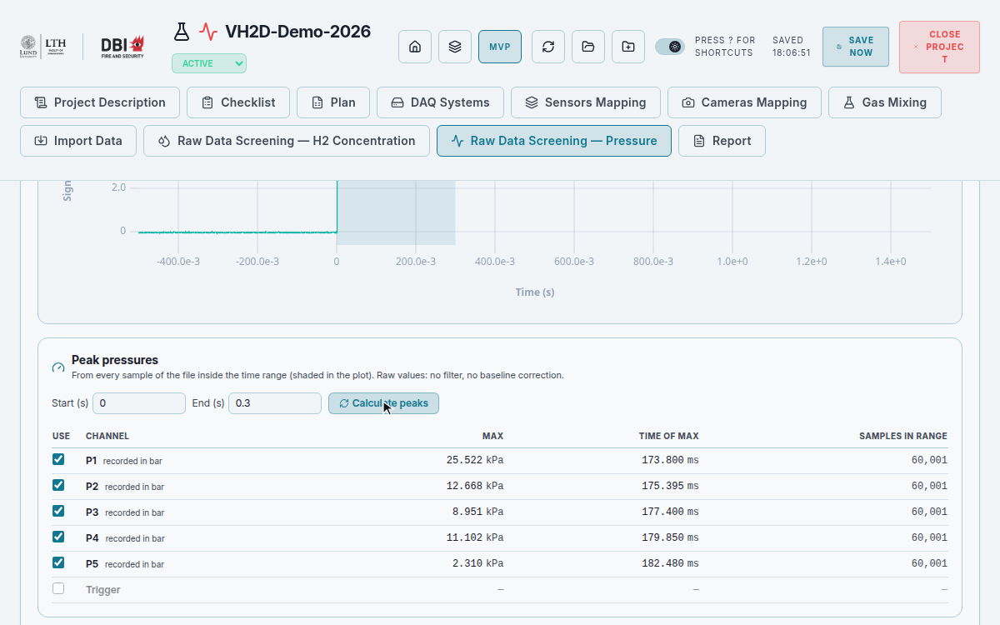

▶ **Video:** [Screen the pressure signals and their peaks](videos/10-screening-pressure.mp4) (14 s)

---

## 12. Raw Data Screening — H2 Concentration

This tab shows the measured hydrogen concentration of the selected file.

- **BGA concentration** values are recorded in ppm; tick *Convert ppm to vol.%*
  to show vol.% (10 000 ppm = 1 vol.%).
- **H2 sensor (H2S) logs** that contain several recordings show a **Recording in
  this file** selector. Recordings are never joined. A recording that is
  identical to one in another run's file is pointed out.

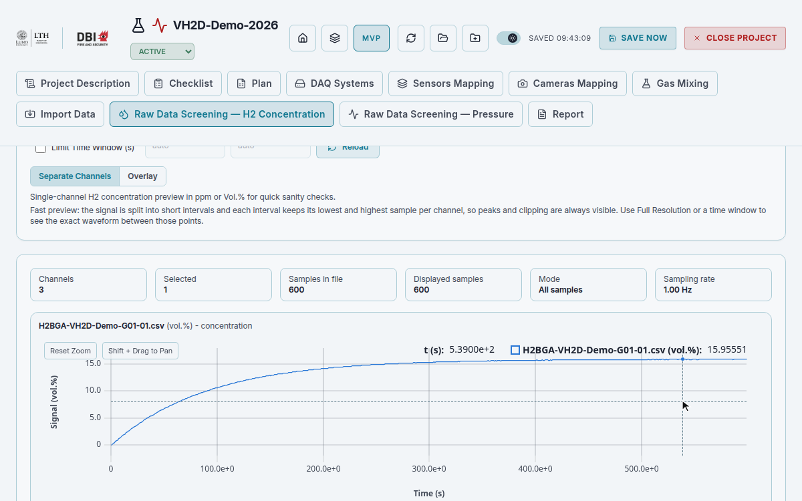

▶ **Video:** [Screen the H2 concentration](videos/11-screening-h2.mp4) (11 s)

---

## 13. Record the actual ignition time

The plan holds planned dates; the actual firing time belongs on the run card.

1. In **Plan**, open the run card (pen icon).
2. Click **Suggest from instrument files**. EXDA lists the time stamps found in
   the run's files, each with its source and time zone (for example the start of
   an MF4 recording, or the last BGA log entry).
3. Click **Use** next to the stamp that matches the ignition, or type the logbook
   time yourself, **with the time zone** (e.g. `2026-12-01T10:05:00+01:00`).
4. Click **Save Run Card**.

Nothing is filled in automatically. Some stamps are only hints: a DAQ start time
can be the same for several runs of one session.

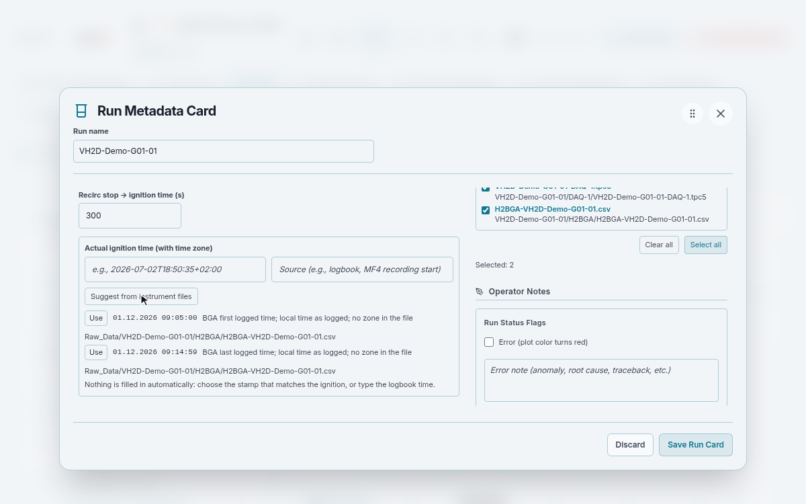

▶ **Video:** [Record the actual ignition time](videos/12-ignition-time.mp4) (12 s)

---

## 14. Report

Open **Report** and click **Export PDF** or **Export CSV**. The metadata report
combines plan, DAQ systems, sensors and cameras mapping and gas mixing.

Reports are saved in the project's `Reports/` folder with the date **and time** in
the file name (e.g. `…_Metadata_Report_2026-12-01_143205.pdf`), so an earlier
report is never overwritten. Plan, DAQ, mapping and gas mixing tables can also be
exported from their own tabs.

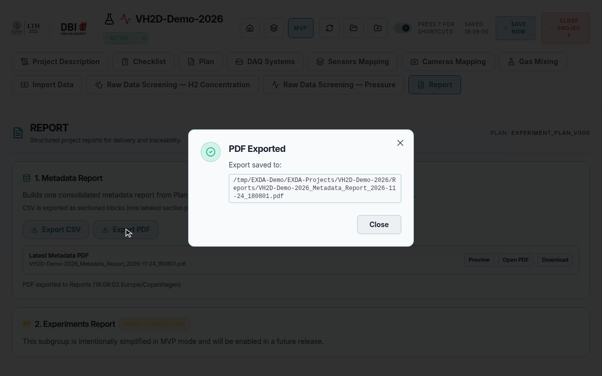

▶ **Video:** [Export the report](videos/13-report.mp4) (8 s)

---

## 15. How EXDA protects your data

- **Raw data is only read.** EXDA never changes the instrument files.
- **Earlier versions are kept.** Before a project file changes, the previous
  version is copied to `History/` and the change (who, when, which field,
  old → new) is written to `History/change_log.jsonl`. The version saved on the
  test day can always be retrieved.
- **Safe saving.** Files are written so that a crash or power cut leaves either
  the old or the new version, never a broken file.
- **One editor per project.** While a project is open for editing in one window
  (on any computer), every other window shows **Read-only** and saves nothing.
  When the first window is closed, the other one can edit after about 30 seconds;
  reload it first. **Take over editing** is only for when the other EXDA crashed.
- **No silent overwrites.** If a file was changed elsewhere after you opened it,
  your save is refused with *“changed elsewhere … reload”* instead of overwriting
  the other change.
- **No silent defaults for measurements.** Missing measured values stay missing;
  EXDA tells you instead of guessing. (See the note on chamber values in
  [Gas Mixing](#9-gas-mixing).)
- **Projects are marked.** Every project folder holds `exda-project.json`; EXDA
  never treats an ordinary folder as a project, and asks before creating project
  folders anywhere.

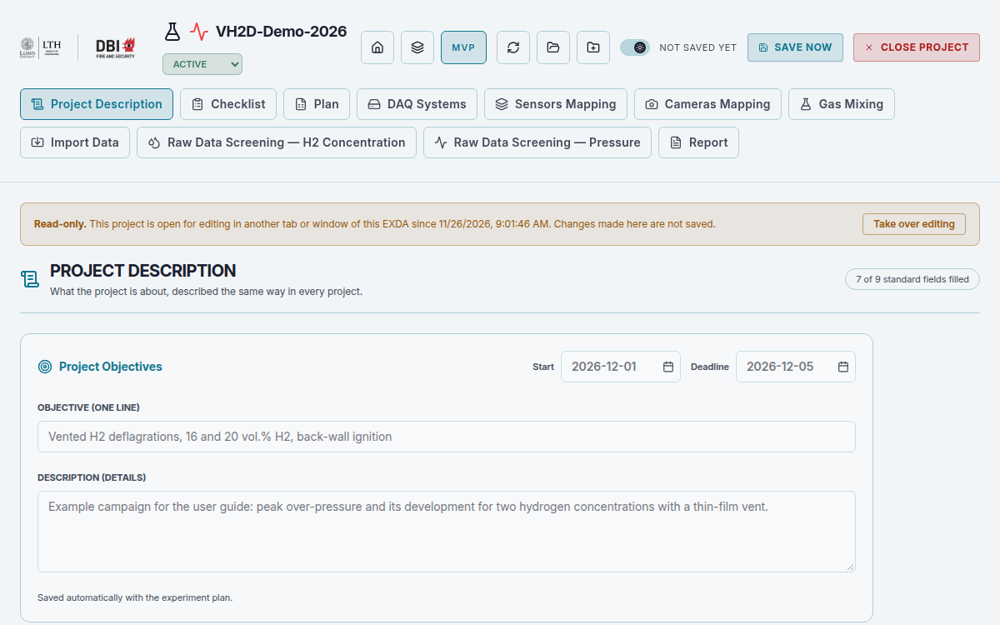

▶ **Video:** [What a second window shows](videos/14-read-only-second-window.mp4) (7 s)

---

## 16. Troubleshooting

| Message or symptom | What to do |
| --- | --- |
| **Read-only** banner | The project is open in another window or on another computer. Close that one and reload this one. Use **Take over editing** only if the other EXDA crashed. |
| *“… was changed elsewhere … reload”* | Someone saved the same file after you opened it. Reload the page, then redo your change. |
| Gas Mixing result marked **STALE** | An input changed after calculating. Click **Calculate** again, then **Save Run**. |
| *“Missing required input …”* in Gas Mixing | Enter the missing measured value; EXDA does not substitute a default. |
| Peak pressures: *“Set a time range …”* | Enter **Start** and **End** (in s) of the event, then click **Calculate peaks**. |
| Peak values cleared | The range or the ticked channels changed; click **Calculate peaks** again. |
| H2S file: *“contains 2 recordings; choose one”* | Choose the recording in **Recording in this file**. |
| A file does not appear in Import Data | Check that it is inside `Raw_Data/<run>/` and has a supported type: csv, txt, dat, asc, mf4, tpc5. |
| *“Not an EXDA project yet”* when opening a folder | You opened a folder without project folders (for example a folder that only groups projects). Click **Cancel** and open one of the projects inside it, or **Create project folders** if it really is a new project. |
| A project is missing from the Projects page | Check that it is inside your projects folder (at most three folder levels deep) and contains `exda-project.json` or a `Plan/` folder with an experiment plan. |
| The first start stops with a message about Node.js or Python | Install the program it names (or accept the offer to install it), then double-click EXDA again. |
